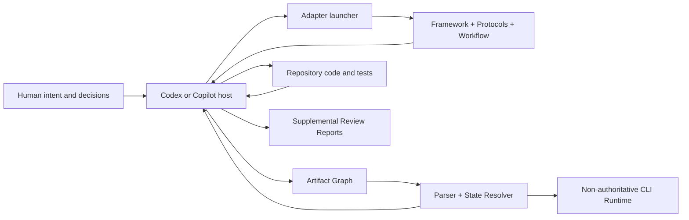
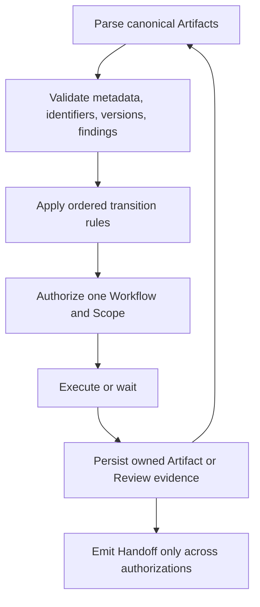
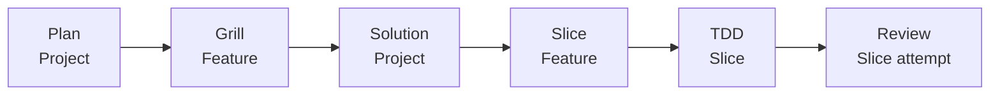
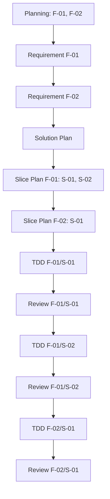
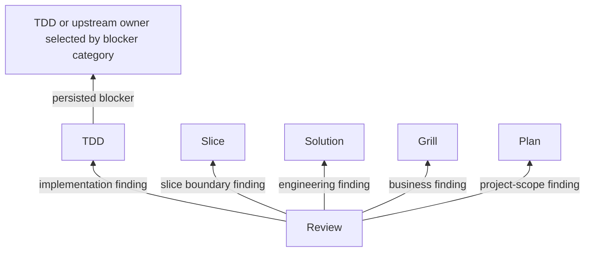
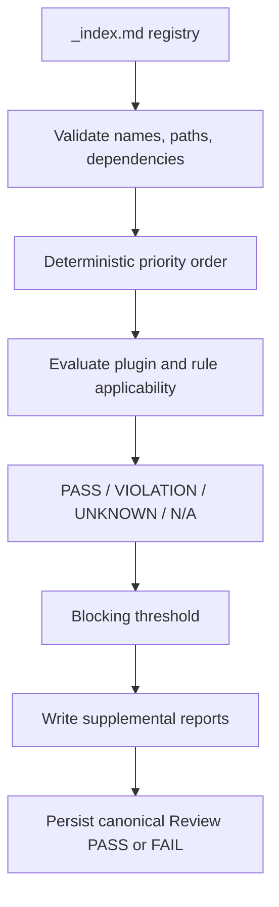

# ForgeFlow Architecture

**A stateful execution protocol for AI-assisted software engineering.**

> **Project status:** Technical Preview
> **Framework:** 2.5 · **Artifact Protocol:** 2.5 · **Handoff Protocol:** 2.7
> **Comparison reviewed:** 2026-08-18

ForgeFlow is not an AI coding agent and does not provide a model. It is a
repository-native control protocol that tells humans and AI agents:

- which engineering evidence is currently authoritative;
- which workflow owns the next decision;
- which Project, Feature, or Slice scope is authorized;
- whether execution may advance, must return, is waiting, is complete, or must halt;
- which exact artifact versions justify that result.

The short version is:

> **Artifacts preserve state. Workflows own decisions. The Artifact Graph
> authorizes execution. Handoffs report validated transfers.**

This document describes the architecture implemented by the current repository. It
is explanatory, not normative. When it conflicts with the framework or protocols,
the normative files listed in [Authoritative sources](#2-authoritative-sources) win.

## Table of contents

1. [Positioning](#1-positioning)
2. [Authoritative sources](#2-authoritative-sources)
3. [Goals and non-goals](#3-goals-and-non-goals)
4. [System context](#4-system-context)
5. [Core architectural model](#5-core-architectural-model)
6. [Artifact Graph](#6-artifact-graph)
7. [Workflow and scope model](#7-workflow-and-scope-model)
8. [Transition and Handoff model](#8-transition-and-handoff-model)
9. [Subsequent change and recovery](#9-subsequent-change-and-recovery)
10. [Execution surfaces](#10-execution-surfaces)
11. [Review plugin architecture](#11-review-plugin-architecture)
12. [Persistence, history, and safety](#12-persistence-history-and-safety)
13. [Repository and package architecture](#13-repository-and-package-architecture)
14. [Verification architecture](#14-verification-architecture)
15. [Comparison with related open-source projects](#15-comparison-with-related-open-source-projects)
16. [ForgeFlow's open-source advantages](#16-forgeflows-open-source-advantages)
17. [Current limitations](#17-current-limitations)
18. [Contribution boundaries](#18-contribution-boundaries)

## 1. Positioning

AI coding agents execute quickly, but speed does not give them durable engineering
state, decision ownership, transition authority, or reliable upstream return
behavior. Those concerns are usually left inside a conversation, a task list, or an
agent-specific runtime.

ForgeFlow inserts an explicit control layer between human intent and agent
execution:

```text
Human Intent
     │
     ▼
Engineering Evidence
     │
     ▼
Deterministic Authorization
     │
     ▼
Workflow-Owned Decision
     │
     ▼
Agent Execution and Verification
     │
     └──────────────► Updated Evidence ──────────────┐
                                                     │
                                                     └── resolve again
```

ForgeFlow is therefore best understood as an opinionated protocol and reference
implementation for **stateful AI-assisted software delivery**, not as another model,
chat interface, autonomous multi-agent system, or generic task manager.

The normative ForgeFlow Core is **agent-agnostic by design**. Its contracts are
Markdown, its state is repository evidence, and its authorization model does not
depend on a particular model API, chat product, or vendor-specific runtime.
Agent-agnostic describes the portability of the Core Protocol; it does not mean
that every host already has a dedicated Adapter or completed acceptance evidence.

## 2. Authoritative sources

ForgeFlow deliberately separates normative contracts from explanatory documents.
The precedence order is:

1. [Framework](./.forgeflow/forgeflow.md)
2. [Artifact Protocol](./.forgeflow/protocol/artifact.md)
3. [Handoff and Transition Protocol](./.forgeflow/protocol/handoff.md)
4. Workflow specifications under [`.forgeflow/workflow/`](./.forgeflow/workflow/)
5. Platform launchers under [`.forgeflow/adapter/`](./.forgeflow/adapter/)
6. Conversation context

The Python engine implements parsing, state resolution, orchestration, and runtime
records. It does not redefine the Markdown contracts. IDE launchers are thin entry
instructions and cannot override them.

## 3. Goals and non-goals

### 3.1 Goals

- Persist project truth in reviewable, version-controlled Markdown.
- Resolve the next authorized Workflow and Scope from current evidence.
- Separate business, engineering, implementation, and review ownership.
- Make forward progress, return, recovery, completion, and invalid state explicit.
- Preserve unaffected evidence during subsequent Plan change.
- Support manual IDE-assisted execution and optional sequential CLI orchestration.
- Keep Review independently owned and extensible through Markdown rules.
- Fail closed when graph evidence is missing, stale, malformed, or contradictory.

### 3.2 Non-goals

- Providing an LLM, model API, hosted service, dashboard, or remote state store.
- Guaranteeing that model-generated requirements, designs, code, or findings are
  correct.
- Replacing source control, CI, static analysis, or human approval.
- Supporting arbitrary user-defined workflow graphs in the current release.
- Orchestrating concurrent distributed agents or background worker fleets.
- Providing code-graph analysis, multi-repository coordination, or MCP services.
- Claiming dedicated compatibility with agents for which no launcher and acceptance
  evidence exist.

## 4. System context



The architecture has five cooperating layers:

| Layer | Current implementation | Responsibility |
| --- | --- | --- |
| Normative contracts | Markdown framework, protocols, workflows | Defines legal behavior and precedence. |
| Authoritative evidence | Canonical Markdown Artifacts | Records current project truth and dependency versions. |
| Deterministic control | Python Artifact Parser, State Resolver, Handoff Parser | Validates evidence and computes authorization. |
| Execution integration | Codex/Copilot launchers and optional Python Runner | Supplies instructions and invokes supported external agent CLIs. |
| Distribution and assurance | Python scaffold, npx installer, tests, CI | Installs the framework and guards architectural invariants. |

## 5. Core architectural model

### 5.1 Four primitives

ForgeFlow is built around four distinct primitives:

| Primitive | Question answered | Authority |
| --- | --- | --- |
| Artifact | What has been decided, implemented, or reviewed? | Persistent project truth. |
| Workflow | Who may make or revise this class of decision? | Artifact ownership contract. |
| Artifact Graph | What work is authorized now? | Deterministic resolution from active evidence. |
| Handoff | What validated cross-authorization result is being reported? | Transfer record; never a replacement for evidence. |

This distinction matters. A Handoff does not make an Artifact true, transfer
Artifact ownership, or independently authorize work. The receiving participant
rebuilds the graph and resolves authorization again.

### 5.2 Control loop



There is no mutable workflow cursor in the authoritative model. A new process can
restart from repository evidence and derive the same next authorization.

## 6. Artifact Graph

### 6.1 Canonical evidence

Active Artifacts live directly under `.forgeflow/artifacts/`:

| Artifact | Owner | Scope | Canonical path | Forward-ready status |
| --- | --- | --- | --- | --- |
| Planning | Plan | Project | `planning.md` | `READY` |
| Requirement | Grill | Feature | `requirement-feature-XX.md` | `READY` |
| Solution Plan | Solution | Project | `solution-plan.md` | `READY` |
| Slice Plan | Slice | Feature | `slice-plan-feature-XX.md` | `READY` |
| TDD Record | TDD | Slice | `tdd-feature-XX-slice-XX.md` | `READY_FOR_REVIEW` |
| Review Report | Review | Slice attempt | `review-feature-XX-slice-XX-attempt-NN.md` | `READY` plus `PASS` or `FAIL` |

Only canonical paths participate in resolution. Supplemental reports, runtime JSON,
conversation text, archived versions, and arbitrary Markdown files are not graph
nodes.

### 6.2 Typed scopes

ForgeFlow models three explicit scopes:

```text
Project
└── Feature: F-XX
    └── Slice: F-XX/S-XX
```

Planning alone declares Feature order. Each Slice Plan alone declares Slice order
within its Feature. Filenames, identifier numbers, timestamps, filesystem order, and
conversation order never override those declarations.

### 6.3 Version edges

Graph edges carry versions rather than implied freshness:

```text
Planning
  └── Feature Contract Version
        └── Requirement Version
              └── Feature Engineering Version in Solution Plan
                    └── Slice Plan Version
                          └── TDD Attempt
                                └── Review Attempt
```

This enables scoped invalidation:

- a later Planning version does not automatically invalidate every Feature;
- unchanged Features retain their Feature Contract Versions;
- a later Solution Plan does not automatically invalidate every Slice;
- unchanged Features retain their Feature Engineering Versions;
- stale TDD and Review evidence cannot satisfy current barriers.

### 6.4 Graph validity

The parser and resolver reject, among other conditions:

- a non-empty Artifact Root without valid Planning;
- missing, duplicate, or malformed required metadata;
- undeclared Feature or Slice references;
- incompatible owner, filename, scope, status, or version data;
- invalid persisted blocker routing;
- malformed Review Findings or count/decision mismatch;
- invalid FAIL disposition;
- downstream evidence beside an explicitly empty project.

A contradictory graph resolves to `TERMINAL / HALTED`; ForgeFlow does not guess a
repair transition.

### 6.5 Project Knowledge View

ForgeFlow does not create a second knowledge-base artifact. The Project Knowledge
View is a read-only projection over validated current Artifacts and preserved
history. It connects Planning Change Sets, Feature Contract Versions, Requirements,
Solution engineering boundaries, Slice Plans, TDD attempts, and Review decisions.

The Python CLI includes this projection in `forge status`, preserving declared
Feature and Slice order and indexing Artifact History, current supplemental Reports,
Reports History, and rotated evidence roots. The view is non-authoritative: it
cannot authorize work, repair missing references, or make historical evidence
current. An invalid graph produces an unavailable view instead of a partial one.

`forge knowledge` provides read-only Feature and Slice filters, optional historical
contract timelines, and JSON or Markdown rendering. The implementation lives in a
dedicated knowledge builder rather than the Artifact parser, keeping validation and
presentation responsibilities separate. Queries reject inactive identifiers and
write to standard output by default.

Artifact Protocol 2.9 adds a migration-safe structured impact model to new or
revised Solution Plans: Feature dependencies, shared-component membership,
engineering-decision references, and the current Solution change classification.
The independent impact analyzer derives reverse and transitive dependents and
shared-component peers without treating co-usage as dependency direction. Legacy
Solutions remain valid but expose an unavailable impact view until revised. Impact
output is non-authoritative and cannot influence Resolver ordering or Handoff scope.

### 6.6 Source and test placement contracts

Artifact Protocol 2.10 moves file organization out of TDD improvisation and into
the engineering baseline. A new or revised Solution records `Implementation
Structure` and `Test Structure`; each Slice records `Planned File Placement`; TDD
records `File Placement Conformance`; Review checks actual paths against the chain.

The policy is Agent- and technology-agnostic. Solution derives package-by-Feature,
package-by-layer, or hybrid organization from repository conventions and explicit
engineering decisions. It separates responsibilities when the contract requires
it, without imposing artificial one-class packages. Unit/component tests mirror
production structure when that is the established or selected convention, while
integration and end-to-end tests may use dedicated declared roots.

Architecture rules distinguish contract from preference. `ARC-003` and `ARC-009`
are P1 checks for explicit source/test layout violations and therefore block under
the built-in architecture threshold. `ARC-008` remains a P2 cohesion recommendation
and cannot fail Review merely because an evaluator prefers another organization.

## 7. Workflow and scope model

### 7.1 Ownership chain



| Workflow | Owns | Decision boundary |
| --- | --- | --- |
| Plan | Planning | Approved project intent, ordered Features, exclusions, project constraints, incremental Change Set. |
| Grill | Requirement | Observable Feature behavior, acceptance criteria, business ambiguity. |
| Solution | Solution Plan | Cross-Feature engineering design, interfaces, data, security, operations, verification strategy. |
| Slice | Slice Plan | Ordered, bounded implementation slices for one Feature. |
| TDD | TDD Record | Implementation and tests for one authorized Slice attempt. |
| Review | Review Report | Independent PASS/FAIL decision and routed findings for one Slice attempt. |

No workflow may modify another workflow's Artifact. Review does not repair code;
TDD does not approve itself; Solution does not invent business outcomes.

### 7.2 Two-dimensional iteration

ForgeFlow does not flatten a project into one unordered task list. Delivery order is
the Cartesian structure of declared Features and their declared Slices:

```text
Feature order
  ×
Slice order within each Feature
```



All Requirements become usable before Solution. All Slice Plans become usable
before TDD begins. TDD and Review then advance in Planning Feature order and Slice
Plan order.

## 8. Transition and Handoff model

### 8.1 Ordered state resolution

The Handoff Protocol defines eleven ordered rules. The first matching rule wins:

| Rule | Condition | Result |
| --- | --- | --- |
| 1 | Empty project | Bootstrap Plan at Project scope. |
| 2 | Contradictory graph | `TERMINAL / HALTED`. |
| 3 | Current persisted blocker | Recover or RETURN to its owner and scope. |
| 4 | Planning not usable | Plan at Project scope. |
| 5 | First missing/stale Requirement | Grill for that Feature. |
| 6 | Solution Plan missing/stale | Solution at Project scope. |
| 7 | First missing/stale Slice Plan | Slice for that Feature. |
| 8 | Current FAIL Review | RETURN to recorded owner and scope. |
| 9 | Current TDD awaits Review | Review for that Slice. |
| 10 | First incomplete Slice needs implementation | TDD for that Slice. |
| 11 | Every declared Slice has current PASS evidence | `TERMINAL / COMPLETE`. |

This ordering gives contradictions and blockers precedence over apparent forward
progress.

### 8.2 Handoff variants

ForgeFlow has three transition types:

- `FORWARD`: report a move to a different next Workflow/Scope authorization;
- `RETURN`: report a move to a prior decision owner or implementation owner;
- `TERMINAL`: report `COMPLETE` or `HALTED`.

Each Canonical Handoff has an exact field set and order. The Python Handoff Parser
validates transition type, scopes, blocker categories, artifact filenames, versions,
terminal evidence, and reason codes.

A workflow emits no Handoff when it remains authorized at the same Workflow and
Scope while waiting for required input. This prevents meaningless self-RETURN loops.

### 8.3 Return semantics

Returns are routed by evidence, not by the agent's preferred destination:



A FAIL Review records blocking findings, selects the highest-precedence owner, and
names one matching affected scope. A persisted non-Review blocker records its own
category, owner, scope, reason, and evidence. Stale blockers and stale Review
attempts remain evidence but cannot authorize recovery.

## 9. Subsequent change and recovery

### 9.1 Subsequent Plan intent

`forge plan --intent "..."` automatically uses Subsequent Plan Entry when current
READY Planning exists. Every later intent is treated as a change to the current
software project; no incremental label or project-identity confirmation is needed.
It is allowed only when:

- the graph is valid;
- Planning is current and `READY`;
- no actionable persisted blocker exists;
- no current FAIL Review is awaiting its owner;
- a non-empty User Intent is supplied.

Plan records an exact Change Set and retains stable Feature IDs. Added or affected
Features receive new contract versions; unaffected Features retain their versions
and usable downstream evidence.

### 9.2 Feature retirement

Removing a Feature is an explicit transaction. Its canonical Artifacts and
supplemental Reports are archived before the higher Planning version becomes
active. Retired identifiers cannot be reused.

### 9.3 Recovery entry

A new process may resume a current persisted blocker without a remembered Handoff.
It rebuilds the graph, applies Rule 3, and re-authorizes only the selected owner and
scope. Runtime history is diagnostic; it is not the recovery authority.

### 9.4 Explicit evidence rotation

Only an explicit reset or archive maintenance operation uses paired Project
Evidence Rotation. Semantic distance between intents never selects rotation.
Active `artifacts/` and `reports/` roots receive the same UTC suffix and are rotated
as one transaction. Partial rotation is rolled back.

## 10. Execution surfaces

### 10.1 Markdown and IDE-assisted execution

ForgeFlow separates the agent-agnostic Core from host-specific integration:

- the Core Protocol defines Artifacts, ownership, scopes, transitions, and
  validation without naming an executing Agent;
- an Adapter translates one host's invocation and instruction conventions into a
  thin launcher without changing Core semantics;
- acceptance evidence belongs to a specific Adapter, host, and version and cannot
  be generalized to every Agent.

Dedicated launchers currently exist for:

| Adapter | Launcher directory | Current claim |
| --- | --- | --- |
| Codex | `.forgeflow/adapter/codex/` | Dedicated launcher files supplied. |
| GitHub Copilot | `.forgeflow/adapter/copilot/` | Dedicated launcher files supplied. |

Launchers read the Framework, Artifact Protocol, Handoff Protocol, and one Workflow
in the required precedence order. They do not register commands by themselves.
Command discovery and invocation syntax remain host-specific.

Other Markdown-capable agents can read the normative files manually, but ForgeFlow
does not currently ship or claim validated dedicated integrations for them.

### 10.2 Python CLI

The optional `forge` CLI provides:

| Command | Responsibility |
| --- | --- |
| `forge init` | Install or refresh managed framework files. |
| `forge plan` | Execute authorized Plan, including default Subsequent Plan intent. |
| `forge run` | Run sequential manual or automatic orchestration. |
| `forge status` | Parse evidence and display graph-derived state. |
| `forge knowledge` | Query current project knowledge by Feature, Slice, dependency impact, or shared component, with optional history and Markdown rendering. |
| `forge reset` | Preview or execute paired evidence rotation. |
| `forge handoff` | Display the latest validated runtime Handoff snapshot. |

The Runner invokes external tools rather than model APIs directly:

- Codex uses `codex exec` with an ephemeral session and workspace-write sandbox.
- Copilot uses `gh copilot` non-interactively with workspace-scoped `write` and
  `shell` permissions.

Execution is sequential. The Runner reparses the graph after each step, rejects a
Handoff that disagrees with graph resolution, records interruptions, and stops after
bounded failures or iterations.

### 10.3 npx installer

`@idairen/forgeflow` is an installer-only Node package:

```bash
npx @idairen/forgeflow@latest init --adapter copilot
```

It supports initialization, adapter selection, and forced refresh. It deliberately
rejects `plan`, `run`, `status`, `reset`, and `handoff`; workflow execution remains
in the Python CLI or IDE-assisted Markdown flow. The npm distribution is implemented
and package-tested but is not claimed as publicly available until published.

### 10.4 Refresh boundary

`init --force` refreshes ForgeFlow-managed framework files while preserving
project-owned Artifacts, Reports, runtime evidence, supported configuration values,
and custom Review plugins. Both installers reject unsafe symbolic-link targets.
There is currently no separate `update` command.

## 11. Review plugin architecture

Review plugins are the supported behavioral extension point. Each plugin supplies a
Markdown `rules.md` file and one registry row containing priority, dependencies,
scope, applicability, report formats, and blocking threshold.



Supplemental plugin reports may use Markdown, CSV, or HTML. They never replace the
canonical Review Report, which must contain all findings required for transition
resolution.

## 12. Persistence, history, and safety

| Storage | Authority | Purpose |
| --- | --- | --- |
| `.forgeflow/artifacts/` | Authoritative | Current contract, implementation, and Review evidence. |
| `.forgeflow/artifacts/history/` | Historical | Replaced or retired canonical evidence. |
| `.forgeflow/reports/` | Supplemental | Current plugin-specific Review detail. |
| `.forgeflow/reports/history/` | Historical | Replaced supplemental reports with revision suffixes. |
| `.forgeflow/runtime/` | Non-authoritative | CLI step history, run summaries, latest validated Handoff snapshot. |

The Project Knowledge View spans these stores without merging their authority.
Current Artifacts define the active baseline; history explains evolution; Reports
remain supplemental; Runtime remains diagnostic.

Safety properties implemented by the current architecture include:

- strict canonical filenames and metadata;
- explicit upstream version references;
- graph-derived authorization before and after execution;
- no shell interpolation when constructing agent CLI commands;
- bounded execution timeout, failures, and total steps;
- interruption recording and process termination;
- atomic JSON writes;
- symlink rejection in installer, runtime, and refresh-sensitive paths;
- paired Artifact/Report rotation with rollback;
- preservation of prior evidence instead of silent overwrite.

These controls reduce workflow and evidence errors. They do not make autonomous
model execution intrinsically safe. Normal branch protection, review, tests, secret
controls, and least-privilege permissions still apply.

## 13. Repository and package architecture

```text
forgeflow/
├── .forgeflow/                 # canonical Markdown framework source
│   ├── adapter/                # Codex and Copilot launchers
│   ├── protocol/               # Artifact and Handoff/Transition protocols
│   ├── rules/reviews/          # Review plugin registry and rules
│   └── workflow/               # six Workflow specifications
├── src/forgeflow/              # Python package
│   ├── cli/                    # forge command surface
│   └── engine/                 # parser, resolver, runner, configuration
├── npm/                        # installer-only Node implementation and tests
├── tests/
│   ├── unit/                   # parser, resolver, and configuration tests
│   ├── integration/            # runner and orchestration tests
│   ├── contracts/              # repository and distribution invariants
│   └── acceptance/ide/         # real-host acceptance assets and result capture
├── examples/sample-project/    # installation walkthrough and valid evidence samples
├── docs/                       # guides, test plans, presentations, and assets
│   └── presentations/          # publication-ready presentation PDFs
├── scripts/                    # reproducible documentation build tools
├── .github/workflows/          # cross-version quality gates
├── forgeflow.json              # canonical project configuration template
├── pyproject.toml              # Python distribution metadata
└── package.json                # npm installer distribution metadata
```

The root `.forgeflow/` directory is not a generated copy. It is the single canonical
framework source embedded by both installers. The sample project intentionally does
not duplicate it.

## 14. Verification architecture

### 14.1 Automated gates

The repository currently verifies:

- strict JSON configuration;
- canonical Artifact parsing and Review Findings validation;
- canonical Handoff variants and scope/evidence rules;
- every forward graph stage, blockers, returns, stale evidence, halt, and complete;
- Runner graph/Handoff agreement and same-authorization rejection;
- incremental-entry boundaries and paired evidence rotation;
- adapter/workflow symmetry and removal of legacy protocol files;
- sample-project graph validity and declared execution order;
- npx initialization, refresh, preservation, symlink safety, and installer-only scope;
- Python compilation, CLI smoke behavior, npm tests, and npm package contents in CI.

### 14.2 Acceptance boundary

Automated tests prove deterministic repository behavior, not model quality or host
behavior. Real Copilot and Codex execution must be evaluated separately using the
IDE acceptance assets under `tests/acceptance/ide/`. A prepared test case is not a passed host
acceptance test until its actual invocation and evidence are captured.

## 15. Comparison with related open-source projects

### 15.1 Method

This comparison uses public official documentation available on 2026-08-18. It is
not a benchmark or a claim that another project lacks undocumented behavior. The
projects solve overlapping but different problems.

| Project | Primary abstraction | Workflow stance | Deterministic control emphasis | Integration breadth | Characteristic strength |
| --- | --- | --- | --- | --- | --- |
| **ForgeFlow** | Versioned Artifact Graph with Workflow/Scope ownership | Fixed, gated six-workflow lifecycle with explicit Return and Recovery | Parser and ordered resolver compute authorization from repository evidence | Agent-agnostic Core; dedicated Codex and Copilot launchers | Lightweight, opinionated execution-control protocol with typed evidence and recovery. |
| **GitHub Spec Kit** | Specification-driven phases, templates, extensions, presets, and bundles | Default Spec → Plan → Tasks → Implement flow; extensible beyond it | Public docs emphasize phase tooling and agent integrations rather than ForgeFlow-style typed graph authorization | Broad documented agent integration catalog | Large integration ecosystem and extensible SDD toolchain. |
| **OpenSpec** | Current specs plus per-change proposal, delta specs, design, tasks, and archive | Explicitly fluid and iterative; artifacts are enablers rather than rigid gates | CLI understands artifact schemas and change state; workflow is intentionally less phase-locked | Broad documented tool support | Lightweight brownfield-friendly agreement and delta/archive model. |
| **BMAD Method** | Specialized agents, agile phases, stories, and context documents | Guided, scale-adaptive lifecycle with quick and full tracks | Public architecture centers guided workflows, agents, and progressive context | Multiple AI development tools through installed skills | Comprehensive role-based methodology and mature workflow/community breadth. |
| **SpecDD** | Small source-adjacent `.sdd` contracts | Simple spec-first loop close to the code | Bootstrap and local authority rules guide agents; intentionally file-first and lightweight | Agent-agnostic by repository-file compatibility | Local, incremental specifications that stay beside implementation. |
| **SpecD** | Specs, changes, schemas, lifecycle, compiled context, and code graph | Configurable lifecycle with verification and optional approvals | Explicitly computes merging, validation, status resolution, delta application, and context | Plugin packages plus CLI; MCP documented as in progress | Broad deterministic SDD platform, schema customization, code graph, and multi-workspace support. |

### 15.2 Architectural interpretation

#### ForgeFlow versus Spec Kit

Spec Kit is stronger in integration breadth, presets, extensions, and community
scale. ForgeFlow is narrower and more opinionated: it treats Workflow/Scope
authorization, blocker precedence, exact Handoff evidence, and restartable graph
resolution as first-class protocol concerns.

Official source: [GitHub Spec Kit](https://github.com/github/spec-kit)

#### ForgeFlow versus OpenSpec

OpenSpec optimizes for an approachable, fluid agreement loop around changes,
deltas, and archive. ForgeFlow intentionally uses stronger barriers and refuses
productive execution when the current graph does not authorize it. OpenSpec's model
is easier to bend; ForgeFlow's model is easier to audit against one declared state
machine.

Official sources: [OpenSpec overview](https://github.com/Fission-AI/OpenSpec/blob/main/docs/overview.md),
[OpenSpec repository](https://github.com/Fission-AI/OpenSpec)

#### ForgeFlow versus BMAD Method

BMAD is a broad, role-oriented methodology with specialized agents, multiple tracks,
and many guided workflows. ForgeFlow uses only six fixed owners and places less
emphasis on agent personas. Its abstraction is not “which expert agent should help?”
but “which evidence-derived owner and scope may act now?”

Official sources: [BMAD workflow map](https://github.com/bmad-code-org/BMAD-METHOD/blob/main/docs/reference/workflow-map.md),
[BMAD Method](https://github.com/bmad-code-org/BMAD-METHOD)

#### ForgeFlow versus SpecDD

SpecDD keeps small contracts beside code and intentionally supports a simple,
agent-agnostic implementation loop. ForgeFlow centralizes lifecycle evidence under
one Artifact Root and adds cross-stage ownership, version chains, Review attempts,
Return routing, and deterministic next-work resolution.

Official source: [SpecDD](https://github.com/specdd/specdd)

#### ForgeFlow versus SpecD

SpecD is the closest comparison in deterministic intent. It is substantially broader:
configurable schemas, compiled context, code graphs, plugins, lifecycle hooks, and
multi-workspace coordination. ForgeFlow's present advantage is not greater feature
breadth; it is a smaller, human-readable, fixed protocol whose full control model can
be inspected in a few Markdown contracts and run without a large runtime stack.

Official source: [SpecD](https://github.com/specd-sdd/SpecD)

## 16. ForgeFlow's open-source advantages

The following are the strongest advantages of the current implementation. They are
architectural properties, not claims of universal uniqueness.

### 16.1 Protocol-first transparency

Core behavior is expressed as versioned Markdown with normative precedence. Humans,
agents, reviewers, and alternative implementations can inspect the same contract
without depending on hidden prompts or hosted state.

### 16.2 Evidence-derived authorization

The next Workflow and Scope are derived from current Artifacts, not from a mutable
conversation, agent assertion, task checkbox, or runtime cursor. This makes restarts,
audits, and independent implementations practical.

### 16.3 Typed ownership and scope

Business, engineering, implementation, and acceptance decisions have separate
owners. Project, Feature, and Slice scopes are explicit graph references, reducing
the common agent failure mode of silently widening work.

### 16.4 Return and recovery as first-class semantics

ForgeFlow models upstream correction rather than treating every failure as “retry
the current task.” Persisted blockers, Review findings, canonical Return routing,
same-authorization waiting, and fresh-process Recovery are part of the protocol.

### 16.5 Feature × Slice iteration

The graph represents both product decomposition and implementation decomposition.
This gives multi-Feature, multi-Slice projects a deterministic completion order and
prevents one successful Slice from being mistaken for project completion.

### 16.6 Scoped incremental evolution

Feature Contract Versions, Feature Engineering Versions, exact Change Sets, and
retirement transactions preserve unaffected evidence while invalidating what truly
changed. Incremental development is a protocol behavior, not an ad hoc prompt.

### 16.7 Evidence lifecycle and auditability

Canonical history, Reports history, immutable Review attempts, paired project
rotation, and non-authoritative runtime separation make replacement and reset
behavior inspectable instead of destructive.

### 16.8 Independent, extensible Review

Review has exclusive PASS/FAIL ownership and cannot repair implementation. Markdown
plugins add ordered security, architecture, coding-standard, and performance checks
without changing the Python engine.

### 16.9 Agent-agnostic Core with explicit Adapter boundaries

The normative Core does not depend on an Agent vendor, model API, or proprietary
state store. Host-specific behavior is isolated in thin Adapters, so a new Agent can
be integrated without redefining Artifact ownership or transition semantics. This
portability claim is deliberately separate from the narrower list of integrations
that ForgeFlow currently ships and has evidence to validate.

### 16.10 Small deployment surface

The normative core is Markdown. The npx installer has no runtime dependencies and
does not duplicate orchestration. The optional Python CLI also has no third-party
runtime dependencies. Teams can adopt the protocol manually before adopting CLI
automation.

### 16.11 Honest verification boundary

ForgeFlow distinguishes protocol tests, installer tests, simulated evidence, and
real IDE acceptance. That distinction is important for an open-source project whose
execution still depends on nondeterministic external agents.

## 17. Current limitations

ForgeFlow should not hide the areas where related projects are currently stronger:

- only Codex and GitHub Copilot have dedicated launchers;
- launcher files do not guarantee host command registration;
- the workflow graph is fixed rather than schema-configurable;
- orchestration is sequential and local;
- there is no code graph, MCP server, dashboard, hosted service, or multi-repository
  coordinator;
- the npm package is implemented but still requires publication for public npx use;
- the Python package is installed from source rather than a documented PyPI release;
- real IDE acceptance remains separate from automated protocol validation;
- Review plugins are LLM-evaluated Markdown contracts, not compiled analyzers;
- Technical Preview status means protocol and integration behavior may still evolve.

These are boundaries for contributors and adopters, not promises of unimplemented
features.

## 18. Contribution boundaries

The current architecture supports contributions in four main areas:

1. **Protocol correctness:** clarify rules while preserving precedence, ownership,
   existing successful scenarios, and executable tests.
2. **Agent adapters:** add thin launchers only after validating the host's actual
   discovery and invocation mechanism.
3. **Review plugins:** add rules and registry entries without transferring canonical
   Review ownership outside the Review Report.
4. **Reference implementation:** improve parsers, resolver, Runner, installers,
   diagnostics, and tests without creating a second source of workflow truth.

Any architectural change should answer:

- Which normative contract owns the behavior?
- Which Artifact and version edge records the decision?
- Which Workflow and Scope may write it?
- Which ordered resolution rule authorizes the next action?
- What happens after restart, stale evidence, failure, interruption, and Return?
- Which automated tests and real-host acceptance evidence support the claim?

That discipline is the core of ForgeFlow's open-source value.
