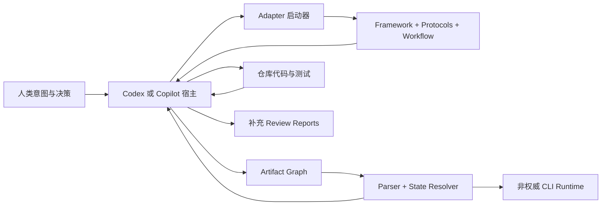
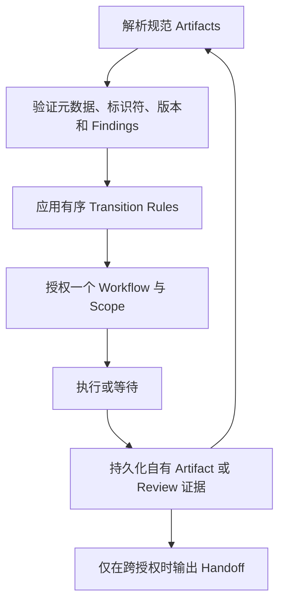
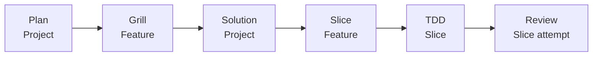
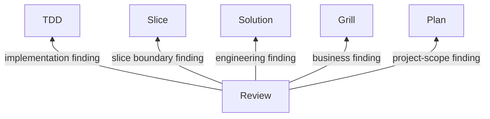
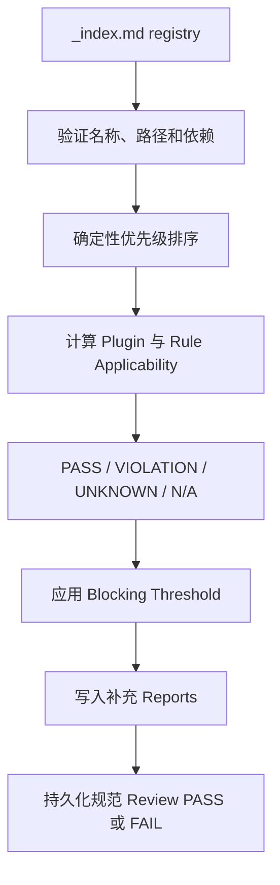

# ForgeFlow 架构

**面向 AI 辅助软件工程的有状态执行协议。**

> **项目状态：** Technical Preview（技术预览）
> **框架版本：** 2.5 · **Artifact Protocol：** 2.5 · **Handoff Protocol：** 2.7
> **横向比较核对日期：** 2026-08-18

[English](./ARCHITECTURE.md)

ForgeFlow 不是 AI 编程 Agent，也不提供模型。它是一个仓库原生的控制协议，用来明确告诉人类和 AI Agent：

- 哪些工程证据当前具有权威性；
- 下一项决策由哪个 Workflow 负责；
- 当前获准执行的是哪个 Project、Feature 或 Slice Scope；
- 流程应当推进、返回、等待、完成，还是停止；
- 哪些精确的 Artifact 版本能够证明这一结论。

可以将 ForgeFlow 概括为：

> **Artifacts 保存状态，Workflows 拥有决策，Artifact Graph 授权执行，Handoffs 报告经过验证的执行转移。**

本文解释当前仓库已经实现的架构，不是规范本身。如果本文与框架或协议发生冲突，以[权威来源](#2-权威来源)中列出的规范文件为准。

## 目录

1. 定位
2. 权威来源
3. 目标与非目标
4. 系统上下文
5. 核心架构模型
6. Artifact Graph
7. Workflow 与 Scope 模型
8. Transition 与 Handoff 模型
9. 增量变更与恢复
10. 执行界面
11. Review 插件架构
12. 持久化、历史与安全
13. 仓库与包架构
14. 验证架构
15. 与相关开源项目的比较
16. ForgeFlow 的开源优势
17. 当前限制
18. 贡献边界

## 1. 定位

AI 编程 Agent 可以快速执行任务，但速度本身不会带来持久的工程状态、明确的决策所有权、可靠的转换授权，也无法保证在实现暴露上游缺口时正确返回。传统方案往往把这些信息留在对话、任务清单或某个 Agent 专属的运行时中。

ForgeFlow 在人类意图和 Agent 执行之间增加了一层显式控制：

```text
Human Intent
     │
     ▼
Engineering Evidence
     │
     ▼
Deterministic Authorization
     │
     ▼
Workflow-Owned Decision
     │
     ▼
Agent Execution and Verification
     │
     └──────────────► Updated Evidence ──────────────┐
                                                     │
                                                     └── resolve again
```

因此，ForgeFlow 更适合被定义为一个面向**有状态 AI 辅助软件交付**的强约束协议和参考实现，而不是新的模型、聊天界面、自治多 Agent 系统或通用任务管理器。

ForgeFlow 的规范核心在设计上是 **Agent-agnostic** 的。它使用 Markdown 表达契约，以仓库证据保存状态，其授权模型不依赖特定模型 API、聊天产品或厂商专属 Runtime。这里的 Agent-agnostic 描述的是 Core Protocol 的可移植性，并不表示每一种宿主都已经具备专用 Adapter 或完成真实验收。

## 2. 权威来源

ForgeFlow 明确区分规范契约和解释性文档。优先级从高到低为：

1. [Framework](./.forgeflow/forgeflow.md)
2. [Artifact Protocol](./.forgeflow/protocol/artifact.md)
3. [Handoff and Transition Protocol](./.forgeflow/protocol/handoff.md)
4. [`.forgeflow/workflow/`](./.forgeflow/workflow/) 下的 Workflow 规范
5. [`.forgeflow/adapter/`](./.forgeflow/adapter/) 下的平台启动器
6. 对话上下文

Python Engine 实现解析、状态解析、编排和运行记录，但不会重新定义 Markdown 契约。IDE 启动器只是轻量入口说明，同样不能覆盖这些契约。

## 3. 目标与非目标

### 3.1 目标

- 使用可审查、可版本控制的 Markdown 保存项目事实。
- 根据当前证据解析下一项获准执行的 Workflow 和 Scope。
- 分离业务、工程、实现和 Review 的决策所有权。
- 显式表达推进、返回、恢复、完成和非法状态。
- 在后续 Plan 变更中保留未受影响的证据。
- 同时支持 IDE 手动执行和可选的 CLI 顺序编排。
- 让 Review 保持独立所有权，并通过 Markdown 规则扩展。
- 在证据缺失、过期、格式错误或相互矛盾时采用失败关闭策略。

### 3.2 非目标

- 提供 LLM、模型 API、托管服务、Dashboard 或远程状态存储。
- 保证模型生成的需求、设计、代码或发现一定正确。
- 替代源代码管理、CI、静态分析或人工批准。
- 在当前版本中支持任意用户自定义 Workflow Graph。
- 编排并发分布式 Agent 或后台 Worker 集群。
- 提供 Code Graph、Multi-repository 协调或 MCP 服务。
- 对没有专用启动器和验收证据的 Agent 宣称已完成集成。

## 4. 系统上下文



当前架构由五个协作层组成：

| 层 | 当前实现 | 职责 |
| --- | --- | --- |
| 规范契约 | Markdown Framework、Protocols、Workflows | 定义合法行为和优先级。 |
| 权威证据 | 规范 Markdown Artifacts | 记录当前项目事实和依赖版本。 |
| 确定性控制 | Python Artifact Parser、State Resolver、Handoff Parser | 验证证据并计算授权。 |
| 执行集成 | Codex/Copilot 启动器与可选 Python Runner | 提供指令并调用受支持的外部 Agent CLI。 |
| 分发与保障 | Python Scaffold、npx Installer、Tests、CI | 安装框架并保护架构不变量。 |

## 5. 核心架构模型

### 5.1 四个基本原语

| 原语 | 回答的问题 | 权威性 |
| --- | --- | --- |
| Artifact | 已经决定、实现或审查了什么？ | 持久化项目事实。 |
| Workflow | 谁可以作出或修改这一类决策？ | Artifact 所有权契约。 |
| Artifact Graph | 现在允许执行什么工作？ | 从当前证据确定性解析授权。 |
| Handoff | 正在报告什么经过验证的跨授权转换？ | 转移记录；不能代替证据。 |

这个区别非常重要。Handoff 不会让 Artifact 自动变为真实，不会转移 Artifact 所有权，也不能独立授权工作。接收方必须重新构建 Artifact Graph 并再次解析授权。

### 5.2 控制循环



权威模型中不存在可变 Workflow Cursor。新进程只依赖仓库证据，就能重新推导出同一个下一授权。

## 6. Artifact Graph

### 6.1 规范证据

当前生效的 Artifacts 直接存放在 `.forgeflow/artifacts/`：

| Artifact | Owner | Scope | 规范路径 | 可向前推进状态 |
| --- | --- | --- | --- | --- |
| Planning | Plan | Project | `planning.md` | `READY` |
| Requirement | Grill | Feature | `requirement-feature-XX.md` | `READY` |
| Solution Plan | Solution | Project | `solution-plan.md` | `READY` |
| Slice Plan | Slice | Feature | `slice-plan-feature-XX.md` | `READY` |
| TDD Record | TDD | Slice | `tdd-feature-XX-slice-XX.md` | `READY_FOR_REVIEW` |
| Review Report | Review | Slice attempt | `review-feature-XX-slice-XX-attempt-NN.md` | `READY` 且为 `PASS` 或 `FAIL` |

只有规范路径参与状态解析。补充报告、Runtime JSON、对话文本、归档版本和任意 Markdown 文件都不是 Graph Node。

### 6.2 类型化 Scope

```text
Project
└── Feature: F-XX
    └── Slice: F-XX/S-XX
```

只有 Planning 可以声明 Feature 顺序；只有对应 Slice Plan 可以声明该 Feature 内的 Slice 顺序。文件名编号、时间戳、文件系统顺序和对话顺序都不能覆盖这些声明。

### 6.3 版本边

```text
Planning
  └── Feature Contract Version
        └── Requirement Version
              └── Feature Engineering Version in Solution Plan
                    └── Slice Plan Version
                          └── TDD Attempt
                                └── Review Attempt
```

版本边支持作用域化失效：

- 新 Planning 版本不会自动让所有 Feature 失效；
- 未变化 Feature 保留原 Feature Contract Version；
- 新 Solution Plan 不会自动让所有 Slice 失效；
- 未变化 Feature 保留原 Feature Engineering Version；
- 过期的 TDD 和 Review 证据不能满足当前 Barrier。

### 6.4 Graph 合法性

Parser 和 Resolver 会拒绝以下情况：

- 非空 Artifact Root 中没有合法 Planning；
- 必需元数据缺失、重复或格式错误；
- 引用了未声明的 Feature 或 Slice；
- Owner、文件名、Scope、Status 或 Version 不兼容；
- 持久化 Blocker 路由非法；
- Review Findings 格式错误，或数量与 Decision 不一致；
- FAIL Disposition 非法；
- 明确为空项目的 Planning 旁存在下游证据。

相互矛盾的 Graph 会解析为 `TERMINAL / HALTED`，ForgeFlow 不会猜测修复路径。

### 6.5 Project Knowledge View

ForgeFlow 不创建第二个知识库 Artifact。Project Knowledge View 是基于已验证当前
Artifacts 与保留历史生成的只读投影，它连接 Planning Change Set、Feature Contract
Version、Requirement、Solution 工程边界、Slice Plan、TDD attempt 与 Review decision。

Python CLI 会在 `forge status` 中输出该投影，保持声明的 Feature/Slice 顺序，并索引
Artifact History、当前补充 Reports、Reports History 和已轮换证据根。该视图不具备
权威性：不能授权工作、修复缺失引用或让历史证据重新生效。Graph 无效时，当前项目
知识直接标记为 unavailable，而不是拼接出一个不完整基线。

`forge knowledge` 提供只读的 Feature/Slice 过滤、可选历史契约时间线，以及 JSON 或
Markdown 渲染。实现位于独立 knowledge builder 中，而不是继续扩大 Artifact Parser，
从而分离验证与展示责任。查询会拒绝非当前标识符，并默认只写标准输出。

Artifact Protocol 2.9 为新建或修订的 Solution Plan 增加兼容迁移的结构化影响模型：
Feature 依赖、共享组件关系、工程决策引用和当前 Solution 变更分类。独立 impact
analyzer 可以推导反向及传递依赖，同时把“共同使用组件”与“存在依赖方向”严格区分。
旧 Solution 仍然有效，但在下一次规范修订补齐元数据前，影响视图明确标记为
unavailable。派生结果不具备权威性，不能影响 Resolver 顺序或 Handoff Scope。

### 6.6 源码与测试布局契约

Artifact Protocol 2.10 不再让 TDD 临时决定文件组织。新建或修订的 Solution 记录
`Implementation Structure` 与 `Test Structure`；Slice 记录 `Planned File
Placement`；TDD 记录 `File Placement Conformance`；Review 沿着这条链验证实际路径。

该规则保持 Agent 与技术栈无关。Solution 根据仓库惯例和明确工程决策选择按 Feature、
按层或混合组织，在契约要求时分离责任，但不制造“一类一包”的形式主义。单元/组件
测试在既有或选定惯例要求时镜像生产结构；集成和端到端测试可以使用明确声明的独立根。

架构规则区分契约与偏好：`ARC-003`、`ARC-009` 是显式源码/测试布局违约的 P1
检查，因此会被内置阈值阻塞；`ARC-008` 是 P2 内聚性建议，不能仅因审查者偏好另一种
组织方式就让 Review FAIL。

## 7. Workflow 与 Scope 模型

### 7.1 所有权链



| Workflow | 拥有的 Artifact | 决策边界 |
| --- | --- | --- |
| Plan | Planning | 项目意图、Feature 顺序、排除项、项目约束和增量 Change Set。 |
| Grill | Requirement | Feature 可观察行为、验收标准和业务歧义。 |
| Solution | Solution Plan | 跨 Feature 工程设计、接口、数据、安全、运维和验证策略。 |
| Slice | Slice Plan | 单个 Feature 的有序、有限实现切片。 |
| TDD | TDD Record | 单个获准 Slice Attempt 的实现和测试。 |
| Review | Review Report | 单个 Slice Attempt 的独立 PASS/FAIL 决策和 Findings 路由。 |

任何 Workflow 都不能修改其他 Workflow 的 Artifact。Review 不修复代码，TDD 不批准自己，Solution 不发明业务结果。

### 7.2 二维迭代

ForgeFlow 不会把项目压平成无序任务列表。交付顺序由两个维度共同组成：

```text
Feature order
  ×
Slice order within each Feature
```

所有 Requirement 可用后才进入 Solution；所有 Slice Plan 可用后才进入 TDD。随后按照 Planning 的 Feature 顺序和每个 Slice Plan 的 Slice 顺序推进 TDD 与 Review。

## 8. Transition 与 Handoff 模型

### 8.1 有序状态解析

Handoff Protocol 定义了十一条有序规则，第一条匹配规则获胜：

| Rule | 条件 | 结果 |
| --- | --- | --- |
| 1 | 空项目 | Bootstrap Plan，Project Scope。 |
| 2 | Graph 相互矛盾 | `TERMINAL / HALTED`。 |
| 3 | 存在当前持久化 Blocker | Recovery 或 RETURN 到其 Owner 与 Scope。 |
| 4 | Planning 不可用 | Plan，Project Scope。 |
| 5 | 第一个缺失或过期 Requirement | Grill，对应 Feature。 |
| 6 | Solution Plan 缺失或过期 | Solution，Project Scope。 |
| 7 | 第一个缺失或过期 Slice Plan | Slice，对应 Feature。 |
| 8 | 当前 Review 为 FAIL | RETURN 到记录的 Owner 与 Scope。 |
| 9 | 当前 TDD 等待 Review | Review，对应 Slice。 |
| 10 | 第一个未完成 Slice 需要实现 | TDD，对应 Slice。 |
| 11 | 所有声明 Slice 都有当前 PASS 证据 | `TERMINAL / COMPLETE`。 |

该顺序确保矛盾和 Blocker 的优先级高于表面上的向前进度。

### 8.2 Handoff 类型

- `FORWARD`：报告转移到不同的下一 Workflow/Scope 授权；
- `RETURN`：报告返回先前决策 Owner 或实现 Owner；
- `TERMINAL`：报告 `COMPLETE` 或 `HALTED`。

Canonical Handoff 的字段集合和顺序固定。Python Handoff Parser 会验证 Transition Type、Scope、Blocker Category、Artifact Filename、Version、Terminal Evidence 和 Reason Code。

当流程仍停留在同一 Workflow 和 Scope 等待输入时，不输出 Handoff，从而避免没有意义的自 RETURN 循环。

### 8.3 Return 语义

Return 由证据路由，而不是由 Agent 自行选择目的地：



FAIL Review 会记录阻塞 Findings，选择最高优先级 Owner，并指定一个匹配的 Affected Scope。非 Review Blocker 会记录自己的 Category、Owner、Scope、Reason 和 Evidence。过期 Blocker 与 Review Attempt 保留为历史证据，但不能授权 Recovery。

## 9. 后续变更与恢复

### 9.1 后续 Plan 意图

当前存在 READY Planning 时，`forge plan --intent "..."` 会自动使用 Subsequent Plan Entry。每次后续意图都视为当前软件项目的变更，不要求用户标记 incremental 或再次确认项目归属。它要求：

- Graph 合法；
- Planning 当前有效且为 `READY`；
- 不存在可执行的持久化 Blocker；
- 不存在等待处理的当前 FAIL Review；
- 提供非空 User Intent。

Plan 记录精确 Change Set，并保持稳定的 Feature ID。新增或受影响 Feature 获得新的 Contract Version；未受影响 Feature 保留原版本和可用下游证据。

### 9.2 Feature 退役

移除 Feature 是一个显式事务。新的 Planning 版本生效前，其规范 Artifacts 和补充 Reports 必须先归档。已经退役的标识符不能复用。

### 9.3 Recovery Entry

新进程可以在没有记忆 Handoff 的情况下恢复当前持久化 Blocker。它重新构建 Graph、应用 Rule 3，并只重新授权选定的 Owner 与 Scope。Runtime History 仅用于诊断，不是 Recovery Authority。

### 9.4 显式证据轮换

只有显式 reset 或 archive maintenance 操作才使用成对的 Project Evidence Rotation。意图之间的语义差异不能触发轮换。当前 `artifacts/` 和 `reports/` 使用同一 UTC 后缀一起轮换；部分轮换会被回滚。

## 10. 执行界面

### 10.1 Markdown 与 IDE 辅助执行

ForgeFlow 将 Agent-agnostic Core 与宿主专属集成明确分层：

- Core Protocol 定义 Artifacts、所有权、Scopes、Transitions 和 Validation，不指定由哪一种 Agent 执行；
- Adapter 将特定宿主的调用方式和指令约定转换为轻量 Launcher，但不能改变 Core Semantics；
- Acceptance Evidence 属于特定 Adapter、宿主和版本，不能直接推广为所有 Agent 都已验证。

目前提供以下专用启动器：

| Adapter | 启动器目录 | 当前承诺 |
| --- | --- | --- |
| Codex | `.forgeflow/adapter/codex/` | 提供专用 Launcher Files。 |
| GitHub Copilot | `.forgeflow/adapter/copilot/` | 提供专用 Launcher Files。 |

Launcher 按规定顺序读取 Framework、Artifact Protocol、Handoff Protocol 和一个 Workflow。Launcher 文件本身不会注册命令，命令发现和调用语法由宿主决定。

其他能够读取 Markdown 的 Agent 可以手动读取规范文件，但 ForgeFlow 当前不提供、也不宣称已经验证它们的专用集成。

### 10.2 Python CLI

可选的 `forge` CLI 提供：

| Command | 职责 |
| --- | --- |
| `forge init` | 安装或刷新受管理框架文件。 |
| `forge plan` | 执行获准 Plan，包括显式增量意图。 |
| `forge run` | 运行顺序 Manual 或 Auto 编排。 |
| `forge status` | 解析证据并显示 Graph 推导状态。 |
| `forge knowledge` | 按 Feature 或 Slice 查询当前项目知识，并可包含历史或输出 Markdown。 |
| `forge reset` | 预览或执行成对 Evidence Rotation。 |
| `forge handoff` | 显示最近一次验证通过的 Runtime Handoff 快照。 |

Runner 调用外部工具，而不是直接调用模型 API：Codex 使用 `codex exec`；Copilot 使用 `gh copilot`。执行为顺序模式。Runner 每一步后重新解析 Graph，拒绝与 Graph Resolution 不一致的 Handoff，并在达到失败或迭代上限时停止。

### 10.3 npx Installer

`@idairen/forgeflow` 是只负责安装的 Node Package：

```bash
npx @idairen/forgeflow@latest init --adapter copilot
```

它支持初始化、Adapter 选择和强制刷新，并明确拒绝 `plan`、`run`、`status`、`reset` 和 `handoff`。Workflow 执行仍属于 Python CLI 或 IDE Markdown 流程。npm 分发已经实现并通过包测试，但在正式发布前不宣称可从公共 Registry 获取。

### 10.4 刷新边界

`init --force` 刷新 ForgeFlow 管理的框架文件，同时保留项目 Artifacts、Reports、Runtime Evidence、受支持配置值和自定义 Review Plugins。两个 Installer 都拒绝不安全的符号链接目标。当前没有独立的 `update` 命令。

## 11. Review 插件架构

Review Plugin 是当前支持的行为扩展点。每个 Plugin 提供 Markdown `rules.md` 和一行 Registry 配置，声明 Priority、Dependencies、Scope、Applicability、Report Formats 和 Blocking Threshold。



补充 Plugin Report 可以使用 Markdown、CSV 或 HTML，但不能替代 Canonical Review Report。转换解析所需的全部 Findings 必须存在于 Canonical Review Report 中。

## 12. 持久化、历史与安全

| Storage | 权威性 | 用途 |
| --- | --- | --- |
| `.forgeflow/artifacts/` | 权威 | 当前契约、实现与 Review 证据。 |
| `.forgeflow/artifacts/history/` | 历史 | 被替换或退役的规范证据。 |
| `.forgeflow/reports/` | 补充 | 当前 Plugin 专属 Review 细节。 |
| `.forgeflow/reports/history/` | 历史 | 带 Revision 后缀的被替换补充 Reports。 |
| `.forgeflow/runtime/` | 非权威 | CLI Step History、Run Summary 和最近 Handoff 快照。 |

当前架构实现的安全属性包括：

- 严格的规范文件名和元数据；
- 显式上游版本引用；
- 执行前后的 Graph 授权验证；
- 构造 Agent CLI 命令时不使用 Shell 插值；
- 有界的执行超时、失败次数和总步骤数；
- 中断记录与进程终止；
- 原子 JSON 写入；
- Installer、Runtime 和 Refresh 路径中的符号链接拒绝；
- Artifact/Report 成对轮换与回滚；
- 保留旧证据，避免静默覆盖。

这些控制减少流程和证据错误，但不能让自主模型执行天然安全。分支保护、人工 Review、测试、Secret 管理和最小权限仍然必不可少。

## 13. 仓库与包架构

```text
forgeflow/
├── .forgeflow/                 # 唯一规范 Markdown 框架源
│   ├── adapter/                # Codex 与 Copilot Launchers
│   ├── protocol/               # Artifact 与 Handoff/Transition Protocols
│   ├── rules/reviews/          # Review Plugin Registry 与 Rules
│   └── workflow/               # 六个 Workflow Specifications
├── src/forgeflow/              # Python Package
│   ├── cli/                    # forge 命令界面
│   └── engine/                 # Parser、Resolver、Runner 与配置
├── npm/                        # 仅安装用途的 Node 实现与测试
├── tests/
│   ├── unit/                   # Parser、Resolver 与配置测试
│   ├── integration/            # Runner 与编排测试
│   ├── contracts/              # 仓库和分发不变量
│   └── acceptance/ide/         # 真实宿主验收资产与结果记录
├── examples/sample-project/    # 安装说明与合法示例证据
├── docs/                       # 指南、测试计划、演示文档和资源
│   └── presentations/          # 可发布的演示 PDF 成品
├── scripts/                    # 可复现的文档构建工具
├── .github/workflows/          # 跨版本质量门禁
├── forgeflow.json              # 规范项目配置模板
├── pyproject.toml              # Python 分发元数据
└── package.json                # npm Installer 分发元数据
```

根目录 `.forgeflow/` 不是生成副本，而是两个 Installer 共同嵌入的唯一规范框架源。Sample Project 不复制框架，避免形成第二份真相。

## 14. 验证架构

### 14.1 自动化门禁

当前仓库验证：

- 严格 JSON 配置；
- Canonical Artifact 解析与 Review Findings 验证；
- Canonical Handoff 类型、Scope 和 Evidence Rules；
- 所有向前阶段、Blocker、Return、Stale Evidence、Halt 和 Complete；
- Runner 的 Graph/Handoff 一致性和相同授权拒绝；
- 增量入口边界与成对 Evidence Rotation；
- Adapter/Workflow 对称性和旧协议文件不会回归；
- Sample Project Graph 合法性与声明执行顺序；
- npx 初始化、刷新、保留策略、符号链接安全和 Installer-only 边界；
- CI 中的 Python 编译、CLI Smoke Test、npm Test 和 npm Package Contents。

### 14.2 验收边界

自动化测试证明的是确定性的仓库行为，不是模型质量或宿主行为。真实 Copilot 和 Codex 执行必须使用 `tests/acceptance/ide/` 下的验收资产独立测试。准备好的 Test Case 只有在实际调用和证据被记录后，才能算作通过宿主验收。

## 15. 与相关开源项目的比较

### 15.1 比较方法

比较依据是截至 2026-08-18 可获得的官方公开文档。它不是性能 Benchmark，也不代表其他项目不存在未公开能力。这些项目解决的问题相互重叠，但重点不同。

| 项目 | 核心抽象 | Workflow 立场 | 确定性控制重点 | 集成广度 | 代表性优势 |
| --- | --- | --- | --- | --- | --- |
| **ForgeFlow** | 带 Workflow/Scope 所有权的版本化 Artifact Graph | 固定、门禁式六 Workflow 生命周期，显式 Return 与 Recovery | Parser 与有序 Resolver 根据仓库证据计算授权 | Agent-agnostic Core；Codex 与 Copilot 专用 Launcher | 轻量、强约束、类型化证据和可恢复的执行控制协议。 |
| **GitHub Spec Kit** | Specification 阶段、Templates、Extensions、Presets 与 Bundles | 默认 Spec → Plan → Tasks → Implement，可扩展 | 公开文档更强调阶段工具和 Agent 集成 | 广泛的公开 Agent 集成目录 | 大型集成生态与可扩展 SDD 工具链。 |
| **OpenSpec** | Current Specs、Change Proposal、Delta Specs、Design、Tasks 与 Archive | 明确强调流动和迭代，Artifact 是助力而不是刚性门禁 | CLI 理解 Artifact Schema 和 Change State，流程限制更少 | 广泛的工具支持 | 轻量、适合 Brownfield 的共识与 Delta/Archive 模型。 |
| **BMAD Method** | 专业化 Agents、Agile Phases、Stories 与 Context Documents | 有引导、按规模自适应，包含 Quick 与 Full Tracks | 强调引导式 Workflows、Agents 和渐进上下文 | 通过 Skills 支持多种 AI 开发工具 | 全面的角色化方法论和成熟的流程广度。 |
| **SpecDD** | 靠近源码的小型 `.sdd` Contracts | 简单的 Spec-first 循环 | Bootstrap 和局部 Authority Rules，刻意保持 File-first | 通过仓库文件兼容实现 Agent-agnostic | 与实现放在一起的局部增量规范。 |
| **SpecD** | Specs、Changes、Schemas、Lifecycle、Compiled Context 与 Code Graph | 可配置生命周期，支持 Verification 与可选 Approval | 显式计算 Merge、Validation、Status、Delta 与 Context | Plugin Packages 与 CLI；MCP 仍在推进 | 广泛的确定性 SDD 平台、Schema、Code Graph 和 Multi-workspace。 |

### 15.2 架构解释

#### ForgeFlow 与 Spec Kit

Spec Kit 在集成广度、Presets、Extensions 和社区规模方面更强。ForgeFlow 更窄、更强约束，把 Workflow/Scope 授权、Blocker 优先级、精确 Handoff Evidence 和可重启 Graph Resolution 作为一等协议概念。

官方来源：[GitHub Spec Kit](https://github.com/github/spec-kit)

#### ForgeFlow 与 OpenSpec

OpenSpec 优化的是围绕 Changes、Deltas 和 Archive 的易用、流动共识循环。ForgeFlow 刻意使用更强 Barrier，在当前 Graph 没有授权时拒绝生产性执行。OpenSpec 更容易调整流程，ForgeFlow 更容易依据单一状态机审计。

官方来源：[OpenSpec overview](https://github.com/Fission-AI/OpenSpec/blob/main/docs/overview.md)、[OpenSpec repository](https://github.com/Fission-AI/OpenSpec)

#### ForgeFlow 与 BMAD Method

BMAD 是覆盖面广的角色化方法论，包含专业 Agents、多条 Track 和大量引导式 Workflow。ForgeFlow 只使用六个固定 Owner，弱化 Agent Persona；它关心的不是“哪个专家 Agent 来帮助”，而是“证据推导出的哪个 Owner 与 Scope 现在可以执行”。

官方来源：[BMAD workflow map](https://github.com/bmad-code-org/BMAD-METHOD/blob/main/docs/reference/workflow-map.md)、[BMAD Method](https://github.com/bmad-code-org/BMAD-METHOD)

#### ForgeFlow 与 SpecDD

SpecDD 把小型 Contract 放在代码附近，支持简单、Agent-agnostic 的实现循环。ForgeFlow 将生命周期证据集中到一个 Artifact Root，并增加跨阶段所有权、Version Chain、Review Attempt、Return Routing 和确定性 Next-work Resolution。

官方来源：[SpecDD](https://github.com/specdd/specdd)

#### ForgeFlow 与 SpecD

SpecD 在确定性目标上最接近 ForgeFlow，但能力范围更广，包括可配置 Schema、Compiled Context、Code Graph、Plugins、Lifecycle Hooks 和 Multi-workspace Coordination。ForgeFlow 当前的优势不是功能更多，而是控制模型更小、更固定、更容易通过少量 Markdown 契约完整检查，并且不依赖大型 Runtime Stack。

官方来源：[SpecD](https://github.com/specd-sdd/SpecD)

## 16. ForgeFlow 的开源优势

以下优势是当前实现已经具备的架构属性，不代表它们在行业中绝对唯一。

### 16.1 Protocol-first 透明性

核心行为通过具有规范优先级的版本化 Markdown 表达。人类、Agent、Reviewer 和替代实现都能检查同一契约，不依赖隐藏 Prompt 或托管状态。

### 16.2 由证据推导授权

下一 Workflow 和 Scope 来自当前 Artifacts，而不是可变对话、Agent 声明、任务勾选框或 Runtime Cursor。这使重启、审计和独立实现变得可行。

### 16.3 类型化所有权与 Scope

业务、工程、实现和验收决策具有独立 Owner；Project、Feature 和 Slice 是显式 Graph Reference，能够减少 Agent 静默扩大工作范围的问题。

### 16.4 Return 与 Recovery 是一等语义

ForgeFlow 模型化上游修正，而不是把所有失败都当作“重试当前任务”。持久化 Blocker、Review Finding、Canonical Return Routing、同授权等待和新进程 Recovery 都属于协议。

### 16.5 Feature × Slice 迭代

Graph 同时表达产品拆分和实现拆分，为多 Feature、多 Slice 项目提供确定的完成顺序，避免把单个 Slice 成功误判为项目完成。

### 16.6 作用域化增量演进

Feature Contract Version、Feature Engineering Version、精确 Change Set 和 Retirement Transaction 保留未受影响证据，只让真正变化的部分失效。增量开发是协议行为，而不是临时 Prompt。

### 16.7 证据生命周期与可审计性

Canonical History、Reports History、不可变 Review Attempts、成对 Project Rotation 和非权威 Runtime 分离，让替换和 Reset 可检查而不是破坏性覆盖。

### 16.8 独立且可扩展的 Review

Review 独占 PASS/FAIL 所有权且不能修复实现。Markdown Plugins 可以增加安全、架构、编码规范和性能检查，而不修改 Python Engine。

### 16.9 Agent-agnostic Core 与显式 Adapter 边界

规范 Core 不依赖某个 Agent 厂商、模型 API 或专有状态存储。宿主专属行为被隔离在轻量 Adapter 中，因此集成新 Agent 不需要重新定义 Artifact Ownership 或 Transition Semantics。这项可移植性声明与当前已经提供、并有证据可验证的较小集成列表严格分开。

### 16.10 小型部署面

规范核心是 Markdown；npx Installer 没有 Runtime Dependency，也不复制编排；可选 Python CLI 同样没有第三方 Runtime Dependency。团队可以先手动采用协议，再引入 CLI 自动化。

### 16.11 诚实的验证边界

ForgeFlow 区分 Protocol Tests、Installer Tests、模拟证据和真实 IDE Acceptance。对于依赖非确定性外部 Agent 执行的开源项目，这种区分非常重要。

## 17. 当前限制

ForgeFlow 不应隐藏相关项目当前更强的方面：

- 只有 Codex 和 GitHub Copilot 提供专用 Launcher；
- Launcher 文件不保证宿主一定完成命令注册；
- Workflow Graph 固定，不能通过 Schema 自定义；
- 编排是本地顺序执行；
- 没有 Code Graph、MCP Server、Dashboard、托管服务或 Multi-repository Coordinator；
- npm Package 虽已实现，但仍需发布后才能公共 npx 使用；
- Python Package 通过源码安装，尚未提供正式 PyPI Release；
- 真实 IDE Acceptance 与自动化 Protocol Validation 分离；
- Review Plugins 是由 LLM 评估的 Markdown Contracts，不是编译型 Analyzer；
- Technical Preview 表示协议和集成行为仍可能演进。

这些内容是贡献者与采用者应了解的边界，不是对未实现能力的承诺。

## 18. 贡献边界

当前架构主要支持四类贡献：

1. **协议正确性：** 在保持优先级、所有权、既有成功场景和可执行测试的前提下澄清规则。
2. **Agent Adapters：** 只有在验证宿主真实发现和调用机制后，才增加轻量 Launcher。
3. **Review Plugins：** 增加 Rules 和 Registry Entry，但不能把 Canonical Review 所有权转移出 Review Report。
4. **参考实现：** 改进 Parser、Resolver、Runner、Installer、Diagnostics 和 Tests，但不能创建第二套 Workflow Truth。

任何架构变更都应回答：

- 哪一个规范契约拥有该行为？
- 哪一个 Artifact 和 Version Edge 记录该决策？
- 哪一个 Workflow 与 Scope 可以写入？
- 哪一条有序 Resolution Rule 授权下一动作？
- 重启、Stale Evidence、Failure、Interruption 和 Return 后会发生什么？
- 哪些自动化测试与真实宿主验收证据支持这一声明？

这种纪律正是 ForgeFlow 的核心开源价值。
