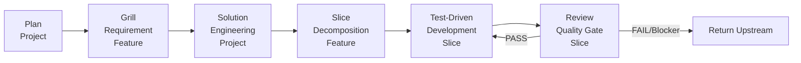

# ForgeFlow

**Repository-native control protocol and workflow orchestrator for AI-assisted software delivery.**
ForgeFlow uses a validated Artifact Graph and typed Handoffs to keep Markdown
evidence authoritative across CLI and IDE-assisted execution.

> **Project status: Technical Preview.** The current implementation provides
> dedicated Codex and GitHub Copilot launchers plus an optional Python CLI. Its
> protocol controls are covered by automated tests, but model output correctness
> and real host behavior still require review and IDE-specific acceptance testing.

---

## Why ForgeFlow?

- 🔄 **Artifact-Driven**: All project state lives in structured Markdown files — no database, external services, or heavy runtimes required.
- 🤖 **Portable Protocol**: Dedicated launchers are supplied for Codex and GitHub Copilot. Other Markdown-capable agents can read the framework manually, but are not currently supported integrations.
- 🔌 **Plugin-Based Reviews**: Extensible review pipeline for security, coding standards, architecture, performance, and more — all defined in pure Markdown rules.
- 🛡️ **Validated Handoffs**: Strict transition validation narrows the authorized next Workflow and Scope, reducing silent state drift without claiming control over every external Agent action.
- ⚡ **Lightweight Core**: The normative framework is Markdown and JSON. The optional dependency-free Python runtime adds parsing, state resolution, validation, and Agent CLI orchestration.

---

## Installation

### Install the framework for IDE use with npx

The `@idairen/forgeflow` npm distribution is an installer only. It copies the
current Markdown framework and `forgeflow.json` into the current project; it does
not install or replace the Python `forge` CLI. Node.js 18 or newer is required.

After a corresponding public npm release is available, run this from the target
project:

```bash
npx @idairen/forgeflow@latest init --adapter copilot   # or codex
```

To refresh ForgeFlow-managed files while preserving project artifacts, reports,
runtime evidence, custom Review plugins, and supported configuration values:

```bash
npx @idairen/forgeflow@latest init --adapter copilot --force
```

The npx package intentionally provides no `plan`, `run`, `status`, `reset`, or
`handoff` command. Install the Python CLI below when command-line orchestration is
required. Until the first public npm release is verified, use a source checkout and
run `node npm/bin/forgeflow.js init --adapter copilot` instead of assuming the
`@latest` command is available.

### Install the optional Python CLI

ForgeFlow is not currently published to PyPI. Install the CLI from a source
checkout with [pipx](https://pipx.pypa.io/) so that `forge` runs in an isolated
environment. Python 3.10 or newer is required.

```bash
git clone https://github.com/idairen/forgeflow-ai.git
cd forgeflow-ai

pipx install .
forge --help
```

Do not use `pip install forgeflow`; no ForgeFlow distribution is currently
published under that PyPI name. If `forge` is not found after installation, run
`pipx ensurepath` and start a new shell.

For an editable development installation:

```bash
python3 -m venv .venv
source .venv/bin/activate
python -m pip install --upgrade pip setuptools wheel
python -m pip install -e .
```

## Quick Start

For IDE-only use after the public npm package is available:

```bash
npx @idairen/forgeflow@latest init --adapter copilot   # or codex
```

For Python CLI orchestration:

```bash
# 1. Initialize a new ForgeFlow project
forge init --adapter copilot   # or codex

# 2. Run the full pipeline in auto-mode
forge run                     # loops until all slices pass review or a blocker is hit
forge run --manual            # execute only the Plan workflow
forge run --reset             # rotate artifacts/ and reports/ before running
```

For a source-checkout walkthrough that installs the canonical framework into a
temporary project and includes protocol-valid comparison artifacts, see
[`examples/sample-project`](./examples/sample-project/README.md).

---

## Architecture Overview

ForgeFlow defines a **gated six-Workflow execution lifecycle** driven by an Artifact
Graph and validated Handoff protocol. Forward progress is ordered, while Return and
Recovery paths deliberately make the model non-linear:



**Read the full deep-dive:**  
📖 [English](./ARCHITECTURE.md) · [中文](./ARCHITECTURE.zh-CN.md) — Current
architecture, state model, execution boundaries, open-source comparison,
advantages, and limitations.

Public guides, testing documentation, and presentations are indexed in
[docs/README.md](./docs/README.md).

---

## CLI Reference

| Command | Description |
|---------|-------------|
| `forge --help` | Show help message |
| `forge plan [--intent TEXT] [--incremental]` | Execute Plan; a later non-empty intent automatically starts a subsequent Plan change (`--incremental` is a compatibility alias) |
| `forge run [--auto\|--manual] [--reset] [--intent TEXT]` | Run using the configured mode or an explicit one-time override. |
| `forge status` | Show current pipeline state, active Artifact Graph, derived Project Knowledge View, history indexes, and handoff data |
| `forge knowledge [--feature F-XX] [--slice F-XX/S-XX] [--impact F-XX] [--component SC-XX] [--history] [--format json\|markdown]` | Query the derived knowledge tree, structured impact model, and optional contract history without changing state |
| `forge reset [--force]` | Rotate active artifacts and supplemental reports (dry-run by default) |
| `forge init [-a copilot\|codex] [--force]` | Install or refresh the framework and create `forgeflow.json` |
| `forge handoff` | Debug tool: display the latest validated CLI handoff snapshot |

CLI exit codes are `0` for success, `1` for execution or configuration errors,
`2` when a pipeline is blocked, halted, or reaches its iteration limit, and `130`
when interrupted by the user.

### Configuration

All project settings live in a single file: [`forgeflow.json`](./forgeflow.json).
Keys include `adapter`, `mode`, `model`, `execution_timeout_seconds`,
and the fixed canonical `root_artifact_dir`. Unknown or malformed fields are rejected.
Pipeline transitions come only from validated canonical Handoff blocks, never
configuration fallbacks.
See [ARCHITECTURE.md](./ARCHITECTURE.md) for the full schema.

`forge status` also renders a read-only `project_knowledge` projection. It preserves
declared Feature/Slice order, links every current contract and execution record by
filename and version, and indexes Artifact/Report history. This projection is for
navigation only: canonical Artifacts remain the sole source of truth, and an invalid
Artifact Graph makes current project knowledge unavailable rather than partially
reconstructing it.

Use `forge knowledge` for a focused view. Feature and Slice filters accept only
active canonical identifiers and preserve declared order. History is opt-in;
Markdown and JSON are rendered to standard output so ForgeFlow does not create a
second, stale knowledge file.

Solutions created under Artifact Protocol 2.9 record structured Feature
dependencies, shared-component membership, decision references, and current change
impact. `--impact F-XX` derives direct and transitive dependents while keeping
shared-component peers separate; `--component SC-XX` lists mapped Features. These
results are navigation aids and never authorize workflow execution. Older Solution
Plans remain readable, but their impact view is explicitly unavailable until the
next normative Solution revision supplies the complete metadata set.

Artifact Protocol 2.10 also treats source and test placement as an engineering
contract. Solution records the repository's implementation and test structure;
Slice maps each planned responsibility to production and test paths; TDD records
actual-path conformance; Review blocks concrete violations. ForgeFlow follows
observable project conventions and does not universally require Java-style layers.
When a layered Java/Spring design is selected, controller, service/use-case,
repository/data-access, domain, and cohesive support responsibilities can be mapped
to separate Feature-local packages with corresponding tests. A catch-all `utility`
package is not a substitute for an explicit responsibility or shared component.

---

## IDE Usage (Copilot / Codex)

ForgeFlow supplies dedicated launcher prompts for two AI coding environments:

- **GitHub Copilot Chat**: Launchers live in `.forgeflow/adapter/copilot/*.prompt.md`. Command names such as `/forge-plan` work only when the host has been configured to discover those prompt files.
- **Codex**: Launchers live in `.forgeflow/adapter/codex/*.prompt.md`; the Python CLI can also invoke `codex exec`.
- **Manual vs Auto Mode**:  
  - `auto-mode`: The engine resolves each step from the active Artifact Graph and accepts a Handoff only when its transition, scope, and evidence versions match that graph.
  - `manual-mode`: The CLI executes Plan once only when the active Artifact Graph authorizes Plan, then validates any emitted Handoff against the updated graph. `--no-auto` remains an alias for `--manual`.
  - `subsequent Plan`: Run `forge plan --intent "..."` for each later requirement or module. READY Planning makes this a Subsequent Plan Entry automatically; no incremental label or project-identity confirmation is required. It preserves active artifacts, reports, and both history roots, and cannot bypass an invalid graph, persisted blocker, or current failed Review. `--incremental` remains only as a compatibility alias.

You can switch the active adapter by editing `forgeflow.json` or running `forge init -a <adapter> --force`. Forced refresh overwrites managed framework files while preserving artifacts, runtime state, custom plugins, and supported project configuration values.

---

## Plugin-Based Review System

ForgeFlow ships with a **pure-Markdown plugin registry**. Add custom review rules without writing Python:

| Built-in Plugin | Purpose |
|-----------------|---------|
| `security` | Vulnerability detection, dependency checks, compliance audit |
| `coding-standard` | PEP8, naming conventions, code style enforcement |
| `architecture` | Design patterns, coupling, modularity assessment |
| `performance` | Anti-patterns, N+1 queries, cache misses, memory leaks |

**How it works:**  
Each plugin defines a `rules.md` checklist under `.forgeflow/rules/reviews/<plugin-name>/`. The Review workflow loads the registry from `_index.md`, executes enabled plugins sequentially, and aggregates verdicts into structured reports.

📖 [PLUGINS.md](./PLUGINS.md) — How to add, configure, and debug custom review plugins.

---

## Artifacts & State Tracking

Canonical workflow artifacts are persisted as Markdown files under `.forgeflow/artifacts/`.
Non-authoritative CLI execution state is stored separately under `.forgeflow/runtime/`.
Example structure:

```
.forgeflow/
├── artifacts/
│   ├── planning.md
│   ├── requirement-feature-01.md
│   ├── solution-plan.md
│   ├── slice-plan-feature-01.md
│   ├── tdd-feature-01-slice-01.md
│   └── review-feature-01-slice-01-attempt-01.md
├── runtime/
│   ├── last-handoff.json
│   ├── last-run.json
│   ├── runs/                  # immutable automatic-run results
│   └── steps/                 # paired Markdown summaries and JSON history entries
├── adapter/
│   ├── copilot/
│   └── codex/
├── workflow/
│   ├── plan.md
│   ├── grill.md
│   └── ...
└── rules/
    └── reviews/
        └── security/
            └── rules.md
```

Each CLI step writes a human-readable Markdown summary and a structured JSON
history entry. New CLI processes rebuild execution history from valid JSON entries;
project evidence rotation preserves this runtime history. Interrupted Agent
executions are recorded before the CLI exits with status `130`.
Automatic runs also persist their final result independently from step history,
including runs that stop because the iteration limit is reached.

When you run `forge run --reset`, ForgeFlow captures one UTC timestamp and rotates
the current artifact graph and any supplemental plugin reports into paired sibling
directories such as `artifacts.20241015093000` and `reports.20241015093000`.
An empty evidence root is recreated but does not receive an empty backup. The
preflight and rollback rules treat both roots as one transaction, preventing reports
from a prior project from being mixed into the next project.

---

## FAQ

### Q: Do I need an LLM API key to run ForgeFlow?
A: The core framework is Markdown-driven, but the `forge` CLI invokes the selected agent CLI for workflow execution. The `codex` adapter runs `codex exec` with a workspace-write sandbox; the `copilot` adapter runs `gh copilot` with workspace-scoped file access and non-interactive `write` and `shell` permissions. Authenticate the selected CLI before running ForgeFlow. Optional `forgeflow.json` keys are `model` and `execution_timeout_seconds` (default: `900`).

### Q: Can I use this without the CLI?
A: Yes. The dedicated Codex and Copilot launchers can drive the Markdown workflows when the host is configured to discover them. Other Markdown-capable agents may read the framework manually, but ForgeFlow does not currently ship or validate dedicated integrations for them. The CLI is optional orchestration and diagnostic tooling.

### Q: How do I add a custom review plugin?
A: Create `.forgeflow/rules/reviews/<your-plugin>/rules.md`, register it in `.forgeflow/rules/reviews/_index.md`, and enable it (`Enabled? = true`). The Review workflow will automatically pick it up. No Python code required.

### Q: Is auto-mode safe for production codebases?
A: ForgeFlow does not claim that autonomous model output is safe for production. Auto-mode rejects invalid transitions and stops on unresolved failures, but the selected agent still receives code-writing and shell capabilities. Run it on an isolated branch or disposable workspace, apply least-privilege host permissions, inspect generated artifacts and code, and require the project's normal review and CI gates before merging.

---

## Contributing

We welcome contributions. Start with [CONTRIBUTING.md](./CONTRIBUTING.md), use
[ARCHITECTURE.md](./ARCHITECTURE.md) for the public architecture, and see
[PLUGINS.md](./PLUGINS.md) for Review extension guidelines. Community expectations,
support boundaries, governance, roadmap direction, and private security reporting
are documented in [CODE_OF_CONDUCT.md](./CODE_OF_CONDUCT.md),
[SUPPORT.md](./SUPPORT.md), [GOVERNANCE.md](./GOVERNANCE.md),
[ROADMAP.md](./ROADMAP.md), and [SECURITY.md](./SECURITY.md).

Before submitting a PR, ensure:
1. Your changes align with the artifact-driven contract (no hardcoded state).
2. Handoff blocks follow the canonical format (`### Handoff` with typed transitions).
3. Plugin rules use the checklist table schema defined in `_index.md`.

Run the local quality gates:

```bash
python3 -m unittest discover -s tests -p 'test_*.py'
npm test
npm pack --dry-run
```

GitHub Actions runs the Python suite on 3.10 and 3.13 and the installer suite on
Node.js 18 and 22. These gates validate deterministic repository behavior; they do
not substitute for real Copilot or Codex acceptance testing.

---

## License

This project is licensed under the [MIT License](./LICENSE).  
Copyright (c) 2026 Dairen.
