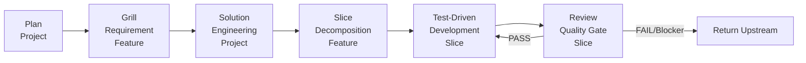

# ForgeFlow

**AI-driven development workflow orchestrator** for CLI and IDE extensions.  
An artifact-driven framework where **Markdown files are the single source of truth**.

---

## Why ForgeFlow?

- 🔄 **Artifact-Driven**: All project state lives in structured Markdown files — no database, external services, or heavy runtimes required.
- 🤖 **AI-Agnostic**: Works seamlessly with Codex CLI, GitHub Copilot Chat, Claude, Gemini, or any model that supports Markdown I/O.
- 🔌 **Plugin-Based Reviews**: Extensible review pipeline for security, coding standards, architecture, performance, and more — all defined in pure Markdown rules.
- 🛡️ **Deterministic Handoffs**: Strict transition protocol ensures every AI agent follows the same decision path, eliminating context drift.
- ⚡ **Zero Runtime Dependency**: The core framework is pure Markdown. Python provides a lightweight CLI orchestrator, but the logic runs entirely through LLM prompts and artifact validation.

---

## Quick Start

```bash
# 1. Install from source (or pip)
pip install -e .

# 2. Initialize a new ForgeFlow project
forge init --adapter copilot   # or codex / claude / gemini
forge init --adapter codex

# 3. Run the full pipeline in auto-mode
forge run                     # loops until all slices pass review or a blocker is hit
forge run --no-auto           # manual: one step at a time, you drive transitions
forge run --reset             # clean artifacts/ before running
```

---

## Architecture Overview

ForgeFlow follows a **6-stage linear pipeline** driven by an artifact graph and deterministic handoff protocol:



**Read the full deep-dive:**  
📖 [ARCHITECTURE.md](./ARCHITECTURE.md) — Workflow graph, handoff protocol, plugin registry, auto-mode engine.

---

## CLI Reference

| Command | Description |
|---------|-------------|
| `forge --help` | Show help message |
| `forge plan [--intent TEXT]` | Execute Plan workflow (Project scope) |
| `forge run [--auto] [--no-auto] [--reset]` | Start pipeline. Auto-mode loops until TERMINAL or blocked. |
| `forge status` | Show current pipeline state, active artifact graph, and handoff data |
| `forge reset [--force]` | Clean up generated artifacts/ (dry-run by default) |
| `forge init [-a copilot\|codex]` | Initialize a new project. Creates `.forgeflow/config.json` |
| `forge handoff` | Debug tool: display the latest handoff block from `artifacts/` |

### Configuration

All project settings live in a single file: [`.forgeflow/config.json`](./.forgeflow/config.json)  
Keys include `adapter`, `mode`, `workflows.*.auto_next`, and `transitions.*.condition`.  
See [ARCHITECTURE.md](./ARCHITECTURE.md) for the full schema.

---

## IDE Usage (Copilot / Codex)

ForgeFlow is designed to work natively inside AI coding assistants:

- **GitHub Copilot Chat**: Use `/forge-plan`, `/forge-grill`, `/forge-solution`, etc. The adapter reads from `.forgeflow/adapter/copilot/*.prompt.md`.
- **Codex CLI**: Pass commands via prompt or use the `forge` subcommands above. Adapters live in `.forgeflow/adapter/codex/*.prompt.md`.
- **Manual vs Auto Mode**:  
  - `auto-mode`: The engine loops through workflows, executing handoff logic automatically until a terminal state or blocker is reached.  
  - `manual-mode`: You drive each step explicitly, inspecting artifacts between phases.

You can switch the active adapter at any time by editing `.forgeflow/config.json` or running `forge init -a <adapter>`.

---

## Plugin-Based Review System

ForgeFlow ships with a **pure-Markdown plugin registry**. Add custom review rules without writing Python:

| Built-in Plugin | Purpose |
|-----------------|---------|
| `security` | Vulnerability detection, dependency checks, compliance audit |
| `coding-standard` | PEP8, naming conventions, code style enforcement |
| `architecture` | Design patterns, coupling, modularity assessment |
| `performance` | Anti-patterns, N+1 queries, cache misses, memory leaks |

**How it works:**  
Each plugin defines a `rules.md` checklist under `.forgeflow/rules/reviews/<plugin-name>/`. The Review workflow loads the registry from `_index.md`, executes enabled plugins sequentially, and aggregates verdicts into structured reports.

📖 [PLUGINS.md](./PLUGINS.md) — How to add, configure, and debug custom review plugins.

---

## Artifacts & State Tracking

All workflow outputs are persisted as Markdown files under `.forgeflow/artifacts/`.  
Example structure:

```
.forgeflow/
├── artifacts/
│   ├── planning.md
│   ├── requirement-feature-01.md
│   ├── solution-plan.md
│   ├── slice-plan-feature-01.md
│   ├── tdd-feature-01-slice-01.md
│   └── review-feature-01-slice-01-attempt-01.md
├── adapter/
│   ├── copilot/
│   └── codex/
├── workflow/
│   ├── plan.md
│   ├── grill.md
│   └── ...
└── rules/
    └── reviews/
        └── security/
            └── rules.md
```

When you run `forge run --reset`, the current artifact graph is rotated into an archive directory (e.g., `artifacts.20241015T093000`) before a fresh run begins. This ensures **zero state drift** between project versions.

---

## FAQ

### Q: Do I need an LLM API key to run ForgeFlow?
A: The core framework is Markdown-driven, but the `forge` CLI invokes an LLM backend for workflow execution. You'll need valid credentials for your chosen adapter (e.g., OpenAI, Anthropic, Gemini).

### Q: Can I use this without the CLI?
A: Yes. ForgeFlow is designed to run purely through IDE prompts (Copilot Chat, Codex, Claude Desktop, etc.). The CLI is an optional orchestrator for automation and debugging.

### Q: How do I add a custom review plugin?
A: Create `.forgeflow/rules/reviews/<your-plugin>/rules.md`, register it in `.forgeflow/rules/reviews/_index.md`, and enable it (`Enabled? = true`). The Review workflow will automatically pick it up. No Python code required.

### Q: Is auto-mode safe for production codebases?
A: Auto-mode loops until blocked or finished. It includes retry logic, fallback transitions, and blocker timeouts. We recommend testing on a staging branch first, then running against `main` with `--reset`.

---

## Contributing

We welcome contributions! Please see [ARCHITECTURE.md](./ARCHITECTURE.md) for the official workflow specification and [PLUGINS.md](./PLUGINS.md) for extension guidelines.  
Before submitting a PR, ensure:
1. Your changes align with the artifact-driven contract (no hardcoded state).
2. Handoff blocks follow the canonical format (`### Handoff` with typed transitions).
3. Plugin rules use the checklist table schema defined in `_index.md`.

---

## License

This project is licensed under the [MIT License](./LICENSE).  
Copyright (c) 2026 Dairen. All rights reserved.
