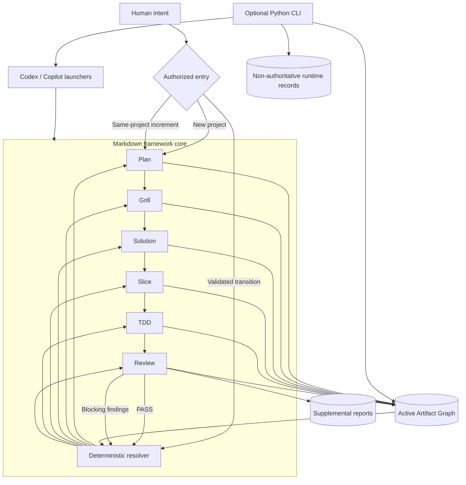

# ForgeFlow: Concept and Architecture Guide

> Public introduction to the current ForgeFlow framework.
>
> Framework version: 2.5 · Artifact Protocol: 2.5 · Handoff Protocol: 2.7 · Workflow specifications: 2.5

[中文版](./forgeflow-concept-and-architecture-guide.zh-CN.md)

## 1. Executive overview

ForgeFlow is an artifact-driven software delivery framework for humans and AI
agents. It turns a software request into a controlled sequence of planning,
requirements clarification, solution design, delivery slicing, test-driven
implementation, and independent review.

The central idea is simple: durable Markdown artifacts, not chat history, record
what the project currently means and what work is authorized next. Every important
decision is owned, versioned, and connected to the decisions it depends on. A
deterministic resolver reads that graph to decide whether work may advance, must
return upstream, is blocked, is complete, or must halt because the evidence is
contradictory.

ForgeFlow can be used directly through Markdown instructions in an AI-assisted
development environment. Its optional Python CLI adds installation, validation,
state inspection, and sequential orchestration for Codex CLI and GitHub Copilot CLI.
The CLI implements the framework; it does not replace or redefine its Markdown
contracts.

## 2. Why ForgeFlow exists

AI-assisted development can move quickly, but speed alone does not provide stable
scope, traceable decisions, or reliable completion evidence. Long conversations can
lose constraints, mix unrelated requests, or allow implementation to begin before
business and engineering decisions are ready.

ForgeFlow addresses these failure modes by making the delivery process explicit:

- **Persistent evidence:** project decisions live in repository files rather than
  transient conversation memory.
- **Clear ownership:** each workflow may change only the artifact it owns.
- **Versioned dependencies:** downstream evidence states exactly which upstream
  contract versions it implements.
- **Deterministic progression:** the current artifact graph, not an agent's guess,
  determines the next workflow and scope.
- **Independent acceptance:** implementation self-checks do not replace Review and
  cannot issue the final PASS decision.
- **Scoped change:** an increment updates only affected business or engineering
  contracts while retaining valid evidence for unchanged Features.

ForgeFlow is therefore best understood as a repository-native control protocol for
AI-assisted software delivery, not as a prompt collection or a project dashboard.

## 3. The mental model

You do not need to learn ForgeFlow's internal specifications before using it. Four
concepts explain the system.

### 3.1 Workflows make decisions

ForgeFlow defines six workflows. Each has a specific responsibility, scope, and
owned output. The separation prevents a single step from silently making business,
architecture, implementation, and acceptance decisions at once.

| Workflow | Question it answers | Scope | Owned artifact |
|---|---|---|---|
| Plan | What Features belong to the approved project scope? | Project | Planning |
| Grill | What must one Feature do, and how will its behavior be accepted? | Feature | Requirement |
| Solution | How will the complete approved scope be engineered? | Project | Solution Plan |
| Slice | How is one Feature divided into ordered, independently verifiable delivery units? | Feature | Slice Plan |
| TDD | How is one authorized Slice implemented and verified? | Slice | TDD Record |
| Review | Does one implementation attempt satisfy its contracts and quality rules? | Slice | Review Report |

Plan and Grill own business decisions. Solution and Slice own engineering design
decisions. TDD changes the product for one authorized Slice. Review evaluates that
attempt independently and is read-only with respect to source code, tests, and
upstream artifacts.

### 3.2 Artifacts form the project memory

Each workflow writes a structured Markdown artifact under
`.forgeflow/artifacts/`. Together, these files form the active Artifact Graph: the
sole persistent source of truth for scope, versions, blockers, implementation
attempts, and review decisions.

Conversation text, adapter prompts, CLI runtime logs, and supplemental plugin
reports can help participants, but none of them overrides the active Artifact Graph.

### 3.3 Handoffs describe transitions

At a workflow boundary, the active participant emits a typed Handoff. A Handoff
records what ran, which evidence was produced, and the next authorization. It does
not transfer artifact ownership and cannot compensate for missing or invalid files.

ForgeFlow recognizes four transition outcomes:

- `FORWARD`: advance to a different workflow or scope.
- `RETURN`: route a blocking gap to the workflow and scope that owns it.
- `TERMINAL / COMPLETE`: all planned Slices have current PASS evidence.
- `TERMINAL / HALTED`: the graph is contradictory and no safe transition can be
  inferred.

When the same workflow remains authorized at the same scope, it continues or waits
without inventing a same-scope Handoff.

### 3.4 The resolver decides what is next

Every invocation rebuilds state from current artifacts. The transition resolver
checks graph validity, persisted blockers, readiness barriers, failed reviews, and
the declared Feature and Slice order. It never uses filename order, identifier
numbers, creation timestamps, or remembered conversation order as work priority.

This makes execution restartable: a new process can determine the next legal action
without relying on the process that ran before it.

## 4. Architecture at a glance



The architecture has four practical layers:

1. **Framework core:** Markdown definitions for workflows, artifacts, transitions,
   and precedence.
2. **Project evidence:** active artifacts plus immutable histories and supplemental
   Review reports.
3. **Adapters:** thin host-oriented launchers that load the same framework rules.
4. **Optional CLI:** a Python implementation that installs framework files,
   validates evidence, resolves state, invokes a supported agent CLI, and records
   non-authoritative execution history.

### 4.1 Rule precedence

When instructions conflict, ForgeFlow applies this order:

1. Framework definition
2. Artifact and Handoff protocols
3. Workflow specifications
4. Adapter launchers
5. Conversation instructions

A participant must stop and report a conflict rather than silently following a
lower-precedence instruction.

## 5. The delivery lifecycle

### 5.1 Business definition

Plan establishes the approved Feature set and its declared order. It records a
Feature-scoped business contract version for every active Feature. Grill then turns
each Feature into a Requirement with behavior, boundaries, and acceptance evidence.

The first global barrier is `BUSINESS_READY`: every planned Feature has a current
READY Requirement matching that Feature's business contract version.

### 5.2 Engineering definition

Solution reads all current Requirements and defines the engineering strategy for
the project, including relevant boundaries, interfaces, data behavior, security,
error handling, operations, and verification. Material unresolved choices must be
raised rather than silently inferred.

Solution records a Feature Engineering Version for every active Feature. The
`ENGINEERING_READY` barrier requires a current READY Solution Plan that references
all current Requirements and those scoped engineering versions.

Slice then creates an ordered Slice Plan for every Feature. A Slice is a deliverable
unit with an explicit verification boundary, not merely a task-list item.
`DELIVERY_READY` is reached only when every active Feature has a current READY Slice
Plan matching its engineering version.

### 5.3 Implementation and review

After `DELIVERY_READY`, ForgeFlow walks Features in Planning order and Slices in
their Slice Plan order. For each Slice:

1. TDD implements only the currently authorized Slice and records its attempt.
2. TDD performs a readiness self-check and reaches `READY_FOR_REVIEW`.
3. Review independently evaluates the implementation and creates an immutable
   Review Report for that attempt.
4. PASS completes the Slice; FAIL routes blocking findings to their owning workflow
   and scope.

A later Feature cannot begin implementation while an earlier Feature still has an
incomplete Slice. `PROJECT_COMPLETE` requires a valid latest PASS Review Report for
every planned Slice.

### 5.4 Readiness barriers

| Barrier | Meaning |
|---|---|
| `BUSINESS_READY` | Every active Feature has a current READY Requirement. |
| `ENGINEERING_READY` | A current READY Solution covers every current Requirement and Feature engineering boundary. |
| `DELIVERY_READY` | Every active Feature has a current READY Slice Plan. |
| `PROJECT_COMPLETE` | Every planned Slice has a current TDD attempt with a matching valid PASS Review Report. |

These are graph-derived conditions, not mutable checklist flags.

## 6. Artifact architecture

### 6.1 Canonical files

Active artifacts live directly under `.forgeflow/artifacts/` using canonical names:

```text
.forgeflow/artifacts/
├── planning.md
├── requirement-feature-01.md
├── solution-plan.md
├── slice-plan-feature-01.md
├── tdd-feature-01-slice-01.md
├── review-feature-01-slice-01-attempt-01.md
└── history/
```

Planning, Requirement, Solution Plan, Slice Plan, and TDD Record have one canonical
active path for their scope. Review Reports are immutable attempt files, so multiple
attempts may coexist as historical control evidence.

Every artifact starts with a title and a `Metadata` table. Metadata identifies its
version, status, scope, upstream references, and any required blocker or review
fields. Artifact versions use `major.minor` form.

### 6.2 Status model

| Artifact type | Allowed status or decision |
|---|---|
| Planning, Requirement, Solution Plan, Slice Plan | `DRAFT`, `BLOCKED`, `READY` |
| TDD Record | `IN_PROGRESS`, `BLOCKED`, `READY_FOR_REVIEW` |
| Review Report | Status `READY`; Decision `PASS` or `FAIL` |

A non-Review artifact in `BLOCKED` state records a category, owner, affected scope,
reason, and evidence. A Review does not create a BLOCKED artifact; its immutable FAIL
report carries the findings and return disposition.

### 6.3 Version edges and freshness

An artifact is usable only when it is structurally valid, has the required ready
status, and references the current upstream versions for its scope. The important
dependency chain is:

```text
Planning Feature Contract Version
  -> Requirement version
  -> Solution Feature Engineering Version
  -> Slice Plan version
  -> TDD attempt
  -> Review Report for that same attempt
```

If an upstream version changes, only evidence whose referenced boundary is no longer
current becomes stale. Stale files remain evidence but cannot satisfy a barrier,
authorize forward progress, or prove completion.

### 6.4 History and immutability

Before an owner replaces a canonical current artifact, it archives the exact prior
file under `.forgeflow/artifacts/history/`. Review Reports already use immutable
attempt filenames and remain in the active root rather than being copied into
artifact history.

Supplemental Review outputs live under `.forgeflow/reports/`. If a plugin output at
the same logical path is replaced, its prior revision is preserved under
`.forgeflow/reports/history/`. Files below either history root do not participate in
current state or current Review evidence.

## 7. Deterministic transitions, blockers, and recovery

The resolver evaluates the graph in a fixed order. In public terms, it performs the
following decisions:

1. Start Plan only when a clean project has no Planning artifact.
2. Halt when the active graph is contradictory.
3. Route a usable current persisted blocker to its owner.
4. Complete missing or stale Planning, Requirements, Solution, and Slice Plans in
   their required order.
5. Route a current failed Review to the owner recorded by its findings.
6. Run Review for a Slice waiting on independent evaluation.
7. Run TDD for the first incomplete Slice that is not waiting on Review.
8. Complete only when every planned Slice has current PASS evidence.

### 7.1 Blocker ownership

| Category | Owner | Scope |
|---|---|---|
| `PLAN_GAP` | Plan | Project |
| `BUSINESS_GAP` | Grill | Feature |
| `ENGINEERING_GAP` | Solution | Project |
| `SLICE_VIOLATION` | Slice | Feature |
| `IMPLEMENTATION_GAP` | TDD | Slice |
| `REVIEW_BLOCKER` | Determined by Review findings | Project, Feature, or Slice according to the owner |

If multiple blockers are actionable, owner precedence is Plan, Grill, Solution,
Slice, then TDD; declared Feature and Slice positions break scope ordering. This
ensures the earliest authoritative gap is repaired before dependent work continues.

### 7.2 Fresh entry modes

Most workflow entries require a validated transition. Three controlled cases can
start without an incoming Handoff:

- **Bootstrap Entry:** Plan begins a clean project.
- **Incremental Intent Entry:** Plan merges an explicitly confirmed same-project
  addition or change.
- **Recovery Entry:** the resolver re-authorizes the exact owner and scope of a
  valid persisted blocker.

No other workflow can use Bootstrap or Incremental Intent Entry.

### 7.3 Invalid graphs fail closed

Examples of contradictions include a non-empty artifact root without Planning,
duplicate active contracts or Review attempts, malformed metadata, unresolved
Feature or Slice identifiers, conflicting version references, and Review counts or
dispositions that do not match their findings.

ForgeFlow responds with `TERMINAL / HALTED`. It does not guess a repair or continue
with a partial interpretation. Productive work resumes only after the contradiction
is corrected outside the invalid transition.

## 8. Review and quality architecture

Review is a separate acceptance authority. TDD must inspect its own work before
requesting Review, but it cannot issue PASS or FAIL and cannot create a Review
Report.

Every Review Report contains one canonical Findings table. Each finding records its
severity, owning workflow, affected scope, evidence, and violated contract.

- PASS means there are zero blocking findings; non-blocking findings may remain.
- FAIL means there is at least one blocking finding.
- When several owners have blocking findings, the return target uses the highest
  upstream precedence: Plan, Grill, Solution, Slice, then TDD.

### 8.1 Markdown review plugins

ForgeFlow includes a Markdown registry at `.forgeflow/rules/reviews/_index.md`.
Enabled plugins run in deterministic priority and dependency order. The current
built-in registry contains:

| Plugin | Current applicability | Formats | Blocking threshold |
|---|---|---|---|
| `security` | Code, documentation, or security-relevant configuration | Markdown, CSV | P0–P1 |
| `coding-standard` | Python source files | Markdown, CSV | P0–P1 |
| `architecture` | Implemented architectural surfaces | Markdown, HTML, CSV | P0–P1 |
| `performance` | Implemented runtime and data-processing surfaces | Markdown, CSV | P0–P1 |

Plugin verdicts are `PASS`, `VIOLATION`, `UNKNOWN`, or `N/A`. Applicability is
evaluated first; `N/A` is not a failure. `UNKNOWN` is non-blocking unless separate
observable evidence meets the blocking definition.

Plugin reports are supplemental evidence. They never replace the canonical Review
Report and are not an independent transition authority. The Review workflow
aggregates applicable findings into the canonical artifact.

## 9. Incremental development within one project

ForgeFlow supports projects whose requirements arrive module by module. A later
request can use Incremental Intent Entry when the user explicitly confirms that it
belongs to the same project and the current graph is valid, has READY Planning, and
has no actionable blocker or current failed Review.

Plan may then add, modify, reorder, or explicitly retire Features while preserving
stable Feature identifiers. Retired identifiers are not reused.

The scoped version model limits invalidation:

- A Planning update advances business contract versions only for affected Features.
- Requirements for unchanged Features remain current.
- Solution analyzes cross-Feature impact and advances engineering versions only
  where needed.
- Slice, TDD, and Review evidence for compatible completed Features remains valid.
- Replaced artifacts and plugin reports are retained in their respective history
  roots.

This is different from starting a new project. Same-project increments preserve the
active artifact and report roots. They do not rotate all project evidence.

### 9.1 New project or explicit reset

An explicitly authorized new project or reset uses Project Evidence Rotation.
ForgeFlow captures one UTC timestamp and rotates both roots as a transaction:

```text
.forgeflow/artifacts.YYYYMMDDHHMMSS
.forgeflow/reports.YYYYMMDDHHMMSS
```

It then creates fresh active artifact and report roots. The shared suffix keeps the
canonical evidence and supplemental reports for the previous project paired. A
partial rotation must be rolled back rather than leaving mixed project evidence.

## 10. How ForgeFlow runs

### 10.1 Markdown and IDE-assisted use

The framework core is entirely Markdown. A compatible participant can read
`.forgeflow/forgeflow.md`, the relevant protocol and workflow files, and the current
Artifact Graph, then perform only the authorized workflow and scope.

ForgeFlow ships dedicated Markdown launcher files for Codex and GitHub Copilot under
`.forgeflow/adapter/codex/` and `.forgeflow/adapter/copilot/`. Claude and Gemini can
use the generic Markdown framework, but no dedicated launcher is supplied.

Launcher files do not by themselves register slash commands in an IDE. The exact
invocation surface depends on the host product's integration and command discovery
mechanism.

### 10.2 Optional CLI

The Python package exposes the `forge` command. Its current public commands are:

| Command | Purpose |
|---|---|
| `forge init [-a copilot\|codex] [--force]` | Install or refresh managed framework files and create project configuration. |
| `forge plan [--intent TEXT] [--incremental]` | Run Plan, including an explicit same-project increment. |
| `forge run [--auto\|--manual] [--reset] [--intent TEXT]` | Execute the configured or one-time selected orchestration mode. |
| `forge status` | Inspect the parsed Artifact Graph and resolved pipeline state. |
| `forge reset [--force]` | Preview or execute paired project evidence rotation. |
| `forge handoff` | Display the latest validated CLI Handoff snapshot for debugging. |

Configuration lives in repository-root `forgeflow.json`. The supported keys are:

| Key | Meaning |
|---|---|
| `adapter` | `codex` or `copilot` |
| `mode` | `auto` or `manual` |
| `root_artifact_dir` | Fixed canonical value `.forgeflow/artifacts` |
| `model` | Optional model name passed to the selected agent CLI |
| `execution_timeout_seconds` | Positive execution timeout; default `900` |

Unknown or malformed fields are rejected.

### 10.3 CLI execution model

In auto mode, the runner repeatedly parses artifacts, resolves the next authorized
workflow and scope, invokes the configured agent CLI, validates the resulting graph
and Handoff, and stops on completion, a blocker, a halt, interruption, or the
iteration limit. The current runner allows up to 50 total steps and stops after
three consecutive execution or Handoff failures for a workflow.

Manual mode executes Plan once only when the graph authorizes Plan, then validates
the result. `forge plan --incremental --intent "..."` is the explicit same-project
entry; a later `forge run` continues from the graph it produced.

The Codex adapter invokes `codex exec` with an ephemeral session and a
`workspace-write` sandbox. The Copilot adapter invokes `gh copilot` non-interactively
with workspace-scoped `write` and `shell` tool permissions. The selected external
CLI must be installed and authenticated. ForgeFlow itself does not provide a model
service or require a separate model API integration.

### 10.4 Runtime records

CLI execution summaries are stored under `.forgeflow/runtime/`, including step
records, final run summaries, and the latest validated Handoff snapshot. These files
support inspection and recovery diagnostics, but they are deliberately
non-authoritative. A new process reconstructs workflow state from the active
artifacts, not from a mutable runtime cursor.

## 11. Repository layout

```text
project/
├── forgeflow.json
└── .forgeflow/
    ├── forgeflow.md
    ├── protocol/
    │   ├── artifact.md
    │   └── handoff.md
    ├── workflow/
    │   ├── plan.md
    │   ├── grill.md
    │   ├── solution.md
    │   ├── slice.md
    │   ├── tdd.md
    │   └── review.md
    ├── adapter/
    │   ├── codex/
    │   └── copilot/
    ├── rules/reviews/
    ├── artifacts/
    │   └── history/
    ├── reports/
    │   └── history/
    └── runtime/
```

The framework, protocols, workflows, adapters, and review rules define behavior.
Artifacts define current project truth. Reports provide supplemental review
evidence. Runtime files describe CLI execution only.

## 12. Current capabilities and boundaries

### 12.1 What ForgeFlow currently provides

- A six-workflow delivery lifecycle with explicit business, engineering,
  implementation, and review ownership.
- Versioned Markdown evidence and deterministic dependency freshness.
- Restartable state resolution without relying on conversation history.
- Controlled forward, return, complete, and halted transitions.
- Persistent blockers and independent, attempt-specific Review decisions.
- Ordered, dependency-aware Markdown review plugins and report history.
- Same-project incremental planning with scoped invalidation.
- Transactional artifact-and-report rotation for a new project or reset.
- Dedicated Codex and Copilot launchers plus optional CLI orchestration.
- Strict parser and Handoff validation in the Python CLI.

### 12.2 What ForgeFlow does not currently claim

- It is not a hosted service, database, project-management dashboard, or remote state
  store.
- It does not provide an LLM, agent account, or authentication for external agent
  CLIs.
- It does not guarantee that an AI-generated design or implementation is correct;
  its controls make decisions and evidence explicit and reviewable.
- It does not provide dedicated Claude or Gemini launchers.
- Its Markdown launchers do not guarantee host-specific slash-command registration.
- Its review plugins are Markdown evaluation contracts, not standalone compiled
  static-analysis engines.
- It does not orchestrate concurrent distributed agents; the current resolver and
  CLI advance work sequentially in declared order.
- It does not treat runtime logs, supplemental reports, or conversation text as
  authoritative project state.

These boundaries are intentional: they keep the framework portable and make its
control decisions inspectable in the repository.

## 13. Getting started

### 13.1 Install framework files with npx

The `@idairen/forgeflow` npm distribution is an installation wrapper for IDE use.
It copies the current Markdown framework and `forgeflow.json` into the target
project. It does not implement the Python CLI, execute workflows, or provide a Node
runtime for the resolver and Runner. Node.js 18 or newer is required.

When consuming the published npm distribution, run this from the target project:

```bash
npx @idairen/forgeflow@latest init --adapter codex   # or copilot
```

Use `--force` to refresh managed framework files while preserving project-owned
Artifacts, Reports, runtime evidence, custom Review plugins, and supported
configuration values. The npx installer exposes no workflow-execution commands.

### 13.2 Use the optional Python CLI from source

The Python CLI remains a separate source installation:

```bash
git clone <forgeflow-repository-url>
cd forgeflow
python3 -m venv .venv
. .venv/bin/activate
python -m pip install --upgrade pip
python -m pip install .
```

In the target project:

```bash
forge init --adapter codex   # or copilot
forge plan --intent "Describe the project outcome"
forge run
forge status
```

Install and authenticate the selected external agent CLI before execution. Use a
version-control branch and review generated changes before merging them.

### 13.3 Add a later module to the same project

```bash
forge plan --incremental --intent "Add the reporting module to this project"
forge run
```

Use incremental mode only when the request truly belongs to the same project. An
ambiguous relationship must be confirmed before evidence changes. Use reset or an
explicit new-project flow when the intent belongs to a different project.

### 13.4 Follow progress

Use `forge status` to inspect the current graph-derived workflow and scope. For
manual or IDE-assisted operation, inspect the active Markdown artifacts directly;
they remain the authoritative explanation of project state.

## 14. Extending and contributing

ForgeFlow's supported extension point is the Markdown Review plugin registry. A
custom plugin supplies a `rules.md` file and a registry entry declaring whether it
is enabled, its priority, dependencies, applicability, output formats, and blocking
threshold.

Changes to workflow sequencing, artifact schemas, ownership, version edges, or
Handoff behavior are framework changes rather than plugins. Contributors should
preserve these architectural invariants:

- Artifacts remain the sole persistent source of truth.
- Every decision has one authoritative owner.
- Downstream progress requires current upstream evidence.
- Transition resolution remains deterministic and fails closed.
- Adapters do not add or override framework rules.
- Supplemental reports and runtime files never become transition authority.

For protocol-level details, contributors can continue with
[`../.forgeflow/forgeflow.md`](../.forgeflow/forgeflow.md),
[`../.forgeflow/protocol/artifact.md`](../.forgeflow/protocol/artifact.md),
[`../.forgeflow/protocol/handoff.md`](../.forgeflow/protocol/handoff.md), and the
workflow files under [`../.forgeflow/workflow/`](../.forgeflow/workflow/). Those
specifications are normative; this guide is their public-facing architectural
explanation.

## 15. Summary

ForgeFlow makes AI-assisted software delivery governable by turning intent,
requirements, design, implementation, and review into a versioned evidence graph.
It advances only when the graph proves that the next step is authorized, preserves
the history needed to understand change, and stops rather than guesses when the
evidence is inconsistent.

That combination—repository-native artifacts, scoped ownership, deterministic
transitions, independent review, and incremental evolution—is the current ForgeFlow
architecture.
