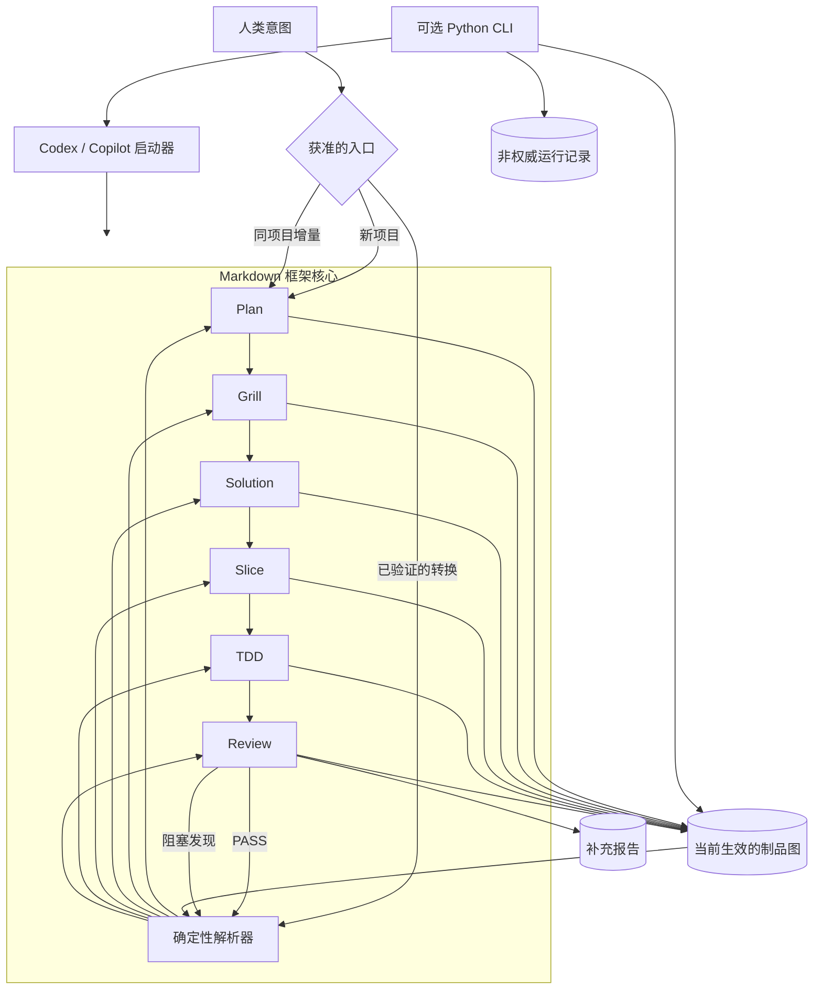

# ForgeFlow：概念与架构指南

> 面向公众介绍当前 ForgeFlow 框架。
>
> 框架版本：2.6 · Artifact Protocol：2.5 · Handoff Protocol：2.8 · 工作流规范：2.5-2.6

[English](./concept-and-architecture.md)

## 1. 概览

ForgeFlow 是一个面向人类和 AI Agent 的、以制品为驱动的软件交付框架。它将软件需求转化为一条受控流程，依次完成项目规划、需求澄清、解决方案设计、交付切片、测试驱动实现和独立审查。

它的核心思想很简单：项目当前的真实含义以及下一步获准执行的工作，由可持久化的 Markdown 制品记录，而不是由聊天历史记录。每一项重要决策都有明确的所有者、版本和依赖关系。确定性的解析器读取这张制品图，判断工作应当继续向前、返回上游、进入阻塞、宣告完成，还是因为证据相互矛盾而停止。

ForgeFlow 可以在 AI 辅助开发环境中直接通过 Markdown 指令使用。可选的 Python CLI 为 Codex CLI 和 GitHub Copilot CLI 提供安装、校验、状态检查和顺序编排能力。CLI 是框架的一种实现和编排器，不会替代或重新定义 Markdown 契约。

## 2. ForgeFlow 要解决什么问题

AI 辅助开发可以很快，但速度本身不能带来稳定的范围、可追溯的决策或可靠的完成证据。较长的对话可能遗漏约束、混入无关需求，也可能在业务和工程决策尚未就绪时就开始实现。

ForgeFlow 通过显式化交付过程来处理这些风险：

- **持久证据：** 项目决策保存在仓库文件中，而不是短暂的对话记忆中。
- **清晰所有权：** 每个工作流只能修改自己拥有的制品。
- **版本化依赖：** 下游证据明确声明其实现的是哪些上游契约版本。
- **确定性推进：** 下一工作流和作用域由当前制品图决定，而不是由 Agent 猜测。
- **独立验收：** 实现阶段的自检不能替代 Review，也不能给出最终 PASS 结论。
- **作用域化变更：** 增量需求只更新受影响的业务或工程契约，未受影响 Feature 的有效证据继续保留。

因此，ForgeFlow 更适合被理解为一个仓库原生的 AI 辅助软件交付控制协议，而不只是提示词集合或项目看板。

## 3. 核心心智模型

使用 ForgeFlow 之前不需要先学习其内部规范。理解下面四个概念即可掌握整个系统。

### 3.1 工作流负责做出决策

ForgeFlow 定义了六个工作流。每个工作流都有明确的职责、作用域和归属制品。这种分离能够避免一个步骤同时、隐式地做出业务、架构、实现和验收决策。

| 工作流 | 回答的问题 | 作用域 | 归属制品 |
|---|---|---|---|
| Plan | 哪些 Feature 属于已批准的项目范围？ | Project | Planning |
| Grill | 单个 Feature 必须具备什么行为，如何验收？ | Feature | Requirement |
| Solution | 完整的已批准范围应当如何进行工程设计？ | Project | Solution Plan |
| Slice | 单个 Feature 如何拆分为有序、可独立验证的交付单元？ | Feature | Slice Plan |
| TDD | 如何实现并验证一个已授权的 Slice？ | Slice | TDD Record |
| Review | 某次实现尝试是否满足契约和质量规则？ | Slice | Review Report |

Plan 和 Grill 负责业务决策；Solution 和 Slice 负责工程设计决策；TDD 只为一个已授权的 Slice 修改产品；Review 独立评估该次实现，并且对源码、测试和上游制品保持只读。

### 3.2 制品构成项目记忆

每个工作流都在 `.forgeflow/artifacts/` 下写入结构化 Markdown 制品。这些文件共同组成当前生效的 Artifact Graph（制品图），它是项目范围、版本、阻塞、实现尝试和审查结论唯一的持久化事实来源。

对话文本、适配器提示、CLI 运行日志以及插件补充报告都可以辅助参与者，但都不能覆盖当前生效的制品图。

### 3.3 Handoff 描述状态转换

当工作流到达边界时，当前参与者会输出一个有类型的 Handoff。Handoff 记录刚刚执行了什么、产出了哪些证据以及下一项授权是什么。它不会转移制品所有权，也不能弥补缺失或无效的文件。

ForgeFlow 识别四种转换结果：

- `FORWARD`：前进到另一个工作流或作用域。
- `RETURN`：将阻塞缺口路由回拥有该问题的工作流和作用域。
- `TERMINAL / COMPLETE`：所有规划的 Slice 都具备当前有效的 PASS 证据。
- `TERMINAL / HALTED`：制品图相互矛盾，无法安全推断下一步。

如果同一个工作流在同一个作用域仍然有效，它会继续执行或等待，而不会虚构一个同作用域 Handoff。

### 3.4 解析器决定下一步

每次调用都会从当前制品重新构建状态。转换解析器依次检查图有效性、持久化阻塞、就绪门禁、失败的 Review，以及声明的 Feature 和 Slice 顺序。它不会使用文件名顺序、标识符数字、创建时间或记忆中的对话顺序来决定工作优先级。

因此执行过程可以安全重启：新进程无需依赖上一个进程的内存，也能确定下一项合法操作。

### 3.5 每次执行只消费一项授权

一次 Workflow 调用只能在已经验证的 Workflow 与 Target Scope 内进行生产性
工作。解析出下一个 Feature、Slice 或 Workflow，并不授权当前调用继续处理它。
当前调用必须输出 Canonical Handoff 并停止；后续调用验证该 Handoff 后，才能在
新的 Scope 工作。

具体来说，Grill 与 Slice 每次执行各处理一个 Feature，TDD 每次实现一个 Slice，
Review 每次检查一个 Slice Attempt。Slice Plan 可以定义多个未来 Slice，但定义
它们并不等于获准执行它们。这个边界防止 Agent 在同一轮中静默消费多个有序工作单元。

## 4. 总体架构



从实践角度看，架构分为四层：

1. **框架核心：** 用 Markdown 定义工作流、制品、转换和优先级。
2. **项目证据：** 当前制品、不可变历史以及 Review 补充报告。
3. **适配器：** 面向不同宿主的轻量启动器，加载同一套框架规则。
4. **可选 CLI：** 一个 Python 实现，负责安装框架文件、校验证据、解析状态、调用受支持的 Agent CLI，并记录非权威执行历史。

### 4.1 规则优先级

当指令发生冲突时，ForgeFlow 按以下顺序处理：

1. 框架定义
2. Artifact 和 Handoff 协议
3. 工作流规范
4. 适配器启动器
5. 对话指令

参与者必须停止并报告冲突，不能默默采用较低优先级的指令。

## 5. 交付生命周期

### 5.1 业务定义

Plan 确立已批准的 Feature 集合及其声明顺序，并为每个当前 Feature 记录一个 Feature 级业务契约版本。随后 Grill 将每个 Feature 转化为 Requirement，描述行为、边界和验收证据。

第一个全局门禁是 `BUSINESS_READY`：每个规划中的 Feature 都具备一个当前 READY Requirement，并且匹配该 Feature 的业务契约版本。

### 5.2 工程定义

Solution 读取全部当前 Requirement，为项目定义工程策略，包括与需求相关的边界、接口、数据行为、安全、错误处理、运维和验证。对于无法安全推断且存在实质取舍的选择，Solution 必须提出问题，而不是静默代替用户决定。

Solution 为每个当前 Feature 记录 Feature Engineering Version。`ENGINEERING_READY` 要求当前 READY Solution Plan 引用了所有当前 Requirement 及其作用域化工程版本。

随后 Slice 为每个 Feature 创建有序的 Slice Plan。Slice 是具有明确验证边界的可交付单元，而不只是任务列表中的一项。只有每个当前 Feature 都具备匹配其工程版本的当前 READY Slice Plan，才会达到 `DELIVERY_READY`。

### 5.3 实现与审查

达到 `DELIVERY_READY` 后，ForgeFlow 按 Planning 中声明的 Feature 顺序，以及各 Slice Plan 中声明的 Slice 顺序推进。对于每个 Slice：

1. TDD 只实现当前获准的 Slice，并记录本次尝试。
2. TDD 完成就绪自检，进入 `READY_FOR_REVIEW`。
3. Review 独立评估实现，为该次尝试创建不可变 Review Report。
4. PASS 完成当前 Slice；FAIL 将阻塞发现路由到其所有者工作流和作用域。

当前一个 Feature 仍存在未完成 Slice 时，后续 Feature 不能开始实现。只有每个规划 Slice 都具备有效的最新 PASS Review Report，才能达到 `PROJECT_COMPLETE`。

### 5.4 就绪门禁

| 门禁 | 含义 |
|---|---|
| `BUSINESS_READY` | 每个当前 Feature 都具备当前 READY Requirement。 |
| `ENGINEERING_READY` | 当前 READY Solution 覆盖所有当前 Requirement 和 Feature 工程边界。 |
| `DELIVERY_READY` | 每个当前 Feature 都具备当前 READY Slice Plan。 |
| `PROJECT_COMPLETE` | 每个规划 Slice 都有当前 TDD 尝试及其匹配的有效 PASS Review Report。 |

这些门禁是从制品图推导出的条件，而不是可变的清单标记。

## 6. 制品架构

### 6.1 规范文件

当前生效的制品使用规范文件名，直接存放在 `.forgeflow/artifacts/` 下：

```text
.forgeflow/artifacts/
├── planning.md
├── requirement-feature-01.md
├── solution-plan.md
├── slice-plan-feature-01.md
├── tdd-feature-01-slice-01.md
├── review-feature-01-slice-01-attempt-01.md
└── history/
```

Planning、Requirement、Solution Plan、Slice Plan 和 TDD Record 在各自作用域只有一个规范的当前路径。Review Report 使用不可变的尝试文件名，因此多个历史尝试可以共存，作为控制证据保留。

每个制品都以标题和 `Metadata` 表开始。元数据标识版本、状态、作用域、上游引用，以及必要的阻塞或 Review 字段。制品版本采用 `major.minor` 格式。

### 6.2 状态模型

| 制品类型 | 允许的状态或结论 |
|---|---|
| Planning、Requirement、Solution Plan、Slice Plan | `DRAFT`、`BLOCKED`、`READY` |
| TDD Record | `IN_PROGRESS`、`BLOCKED`、`READY_FOR_REVIEW` |
| Review Report | 状态为 `READY`；结论为 `PASS` 或 `FAIL` |

非 Review 制品处于 `BLOCKED` 时，会记录类别、所有者、受影响作用域、原因和证据。Review 不创建 BLOCKED 制品；其不可变 FAIL 报告负责承载发现和返回处置。

### 6.3 版本边与新鲜度

只有结构有效、具备所需就绪状态、并且引用了其作用域内当前上游版本的制品，才可用于推进。关键依赖链为：

```text
Planning Feature Contract Version
  -> Requirement version
  -> Solution Feature Engineering Version
  -> Slice Plan version
  -> TDD attempt
  -> 同一次 attempt 的 Review Report
```

当上游版本发生变化时，只有引用边界不再有效的证据会变为过期。过期文件仍作为历史证据保留，但不能满足门禁、授权向前推进或证明项目完成。

### 6.4 历史与不可变性

所有者替换规范当前制品之前，必须将原文件的精确副本归档到 `.forgeflow/artifacts/history/`。Review Report 已经采用不可变尝试文件名，因此保留在当前根目录中，不复制到 artifact history。

Review 插件的补充输出位于 `.forgeflow/reports/`。如果同一逻辑路径的插件输出被替换，之前的修订版会保存在 `.forgeflow/reports/history/`。两个 history 根目录下的文件都不参与当前状态或当前 Review 证据计算。

## 7. 确定性转换、阻塞与恢复

解析器按照固定顺序评估制品图。用面向使用者的语言描述，它会做出以下判断：

1. 只有干净项目不存在 Planning 时，才通过 Plan 启动。
2. 当前制品图相互矛盾时停止。
3. 将可用的当前持久化阻塞路由给其所有者。
4. 按要求顺序补齐缺失或过期的 Planning、Requirement、Solution 和 Slice Plan。
5. 将当前失败 Review 路由给其发现记录的所有者。
6. 对等待独立评估的 Slice 执行 Review。
7. 对第一个未完成且当前不等待 Review 的 Slice 执行 TDD。
8. 只有所有规划 Slice 都具备当前 PASS 证据时才宣告完成。

### 7.1 阻塞所有权

| 类别 | 所有者 | 作用域 |
|---|---|---|
| `PLAN_GAP` | Plan | Project |
| `BUSINESS_GAP` | Grill | Feature |
| `ENGINEERING_GAP` | Solution | Project |
| `SLICE_VIOLATION` | Slice | Feature |
| `IMPLEMENTATION_GAP` | TDD | Slice |
| `REVIEW_BLOCKER` | 由 Review findings 决定 | 根据所有者为 Project、Feature 或 Slice |

如果多个阻塞同时可执行，所有者优先级依次为 Plan、Grill、Solution、Slice、TDD；同一层级内再根据声明的 Feature 和 Slice 位置排序。这样可以保证先修复最上游、最具权威性的缺口，再继续依赖它的工作。

### 7.2 无传入 Handoff 的入口

大多数工作流入口都需要经过验证的转换。只有三种受控场景可以在没有传入 Handoff 时启动：

- **Bootstrap Entry：** Plan 启动一个干净项目。
- **Incremental Intent Entry：** Plan 合并一个已明确确认属于同项目的新增或变更需求。
- **Recovery Entry：** 解析器重新授权某个有效持久化阻塞的精确所有者和作用域。

除 Plan 外，其他工作流不能使用 Bootstrap 或 Incremental Intent Entry。

### 7.3 无效制品图采用失败关闭

矛盾示例包括：非空 artifact root 中没有 Planning、重复的当前契约或 Review attempt、元数据格式错误、无法解析的 Feature 或 Slice 标识符、冲突的版本引用，以及 Review 数量或返回处置与 findings 不一致。

ForgeFlow 会返回 `TERMINAL / HALTED`，不会猜测修复方式，也不会基于局部解释继续执行。只有在无效转换之外修复制品矛盾后，才能恢复生产性工作。

## 8. Review 与质量架构

Review 是独立的验收权威。TDD 在请求 Review 前必须检查自己的工作，但不能给出 PASS 或 FAIL，也不能创建 Review Report。

每份 Review Report 都包含唯一一张规范 Findings 表。每条 finding 都会记录严重级别、所有者工作流、受影响作用域、证据和违反的契约。

- PASS 表示阻塞 finding 数量为零；可以保留非阻塞 finding。
- FAIL 表示至少存在一条阻塞 finding。
- 当多个所有者都有阻塞 finding 时，返回目标按上游优先级选择：Plan、Grill、Solution、Slice、TDD。

### 8.1 Markdown Review 插件

ForgeFlow 在 `.forgeflow/rules/reviews/_index.md` 提供 Markdown 插件注册表。已启用插件按照确定性的优先级和依赖顺序执行。当前内置注册表包括：

| 插件 | 当前适用范围 | 格式 | 阻塞阈值 |
|---|---|---|---|
| `security` | 代码、文档或安全相关配置 | Markdown、CSV | P0–P1 |
| `coding-standard` | Python 源码 | Markdown、CSV | P0–P1 |
| `architecture` | 已实现的架构表面 | Markdown、HTML、CSV | P0–P1 |
| `performance` | 已实现的运行时和数据处理表面 | Markdown、CSV | P0–P1 |

插件结论为 `PASS`、`VIOLATION`、`UNKNOWN` 或 `N/A`。系统先判断适用性；`N/A` 不代表失败。`UNKNOWN` 默认不阻塞，除非存在其他可观察证据满足阻塞定义。

插件报告只是补充证据，不能替代规范 Review Report，也不是独立的转换权威。Review 工作流负责将适用 findings 聚合进规范制品。

## 9. 同一项目的增量开发

ForgeFlow 支持需求按模块逐步到达的项目。当用户明确确认后续请求属于同一个项目，并且当前制品图有效、Planning 为 READY、没有可执行阻塞或当前 FAIL Review 时，可以使用 Incremental Intent Entry。

随后 Plan 可以新增、修改、重排或明确退役 Feature，同时保留稳定的 Feature 标识符。已退役标识符不会被复用。

作用域化版本模型会限制失效范围：

- Planning 更新只推进受影响 Feature 的业务契约版本。
- 未变化 Feature 的 Requirement 继续有效。
- Solution 分析跨 Feature 影响，只在必要时推进工程版本。
- 兼容且已完成 Feature 的 Slice、TDD 和 Review 证据继续有效。
- 被替换的制品和插件报告分别保存在各自 history 根目录中。

这与启动新项目不同。同项目增量会保留当前 artifact root 和 reports root，不会轮换全部项目证据。

### 9.1 新项目或显式重置

明确授权的新项目或 reset 会使用 Project Evidence Rotation。ForgeFlow 获取一个 UTC 时间戳，并将两个根目录作为同一个事务轮换：

```text
.forgeflow/artifacts.YYYYMMDDHHMMSS
.forgeflow/reports.YYYYMMDDHHMMSS
```

随后创建新的当前 artifact root 和 reports root。相同后缀可以将上一项目的规范证据与补充报告对应起来。如果轮换只完成一部分，必须回滚，而不能留下混合的项目证据。

## 10. ForgeFlow 如何运行

### 10.1 Markdown 与 IDE 辅助使用

框架核心完全由 Markdown 构成。兼容的参与者可以读取 `.forgeflow/forgeflow.md`、相关协议和工作流文件，以及当前制品图，然后只执行已授权的工作流和作用域。

ForgeFlow 在 `.forgeflow/adapter/codex/` 和 `.forgeflow/adapter/copilot/` 下提供专用 Markdown 启动器。Claude 和 Gemini 可以通用方式读取 Markdown 框架，但当前没有提供专用启动器。

启动器文件本身不会在 IDE 中自动注册斜杠命令。准确的调用方式取决于宿主产品的集成机制和命令发现机制。

### 10.2 可选 CLI

Python 包提供 `forge` 命令。当前公开命令包括：

| 命令 | 用途 |
|---|---|
| `forge init [-a copilot\|codex] [--force]` | 安装或刷新受管理的框架文件，并创建项目配置。 |
| `forge plan [--intent TEXT] [--incremental]` | 执行 Plan，包括显式同项目增量。 |
| `forge run [--auto\|--manual] [--reset] [--intent TEXT]` | 使用配置模式或一次性指定模式执行编排。 |
| `forge status` | 检查解析后的制品图和流程状态。 |
| `forge reset [--force]` | 预览或执行成对的项目证据轮换。 |
| `forge handoff` | 显示最近一次已验证 CLI Handoff 快照，用于调试。 |

配置位于仓库根目录的 `forgeflow.json`。支持的配置项为：

| 配置项 | 含义 |
|---|---|
| `adapter` | `codex` 或 `copilot` |
| `mode` | `auto` 或 `manual` |
| `root_artifact_dir` | 固定规范值 `.forgeflow/artifacts` |
| `model` | 可选模型名，传递给所选 Agent CLI |
| `execution_timeout_seconds` | 正数执行超时；默认值为 `900` |

未知或格式错误的字段会被拒绝。

### 10.3 CLI 执行模型

在 auto 模式下，Runner 会重复解析制品、解析下一项获准的工作流和作用域、调用配置的 Agent CLI、校验执行后的制品图和 Handoff，并在完成、阻塞、停止、中断或达到迭代上限时退出。当前 Runner 最多执行 50 个总步骤；同一工作流连续出现三次执行或 Handoff 失败时会停止。

manual 模式只在制品图授权 Plan 时执行一次 Plan，随后校验结果。`forge plan --incremental --intent "..."` 是显式的同项目入口；后续 `forge run` 从它生成的制品图继续。

Codex 适配器以临时会话和 `workspace-write` sandbox 调用 `codex exec`。Copilot 适配器以非交互方式调用 `gh copilot`，并授予工作区范围的 `write` 和 `shell` 工具权限。所选外部 CLI 必须已安装并完成认证。ForgeFlow 本身不提供模型服务，也不要求独立集成模型 API。

### 10.4 运行记录

CLI 执行摘要存放在 `.forgeflow/runtime/` 下，包括步骤记录、最终运行摘要和最近一次已验证 Handoff 快照。这些文件用于检查和恢复诊断，但被明确设计为非权威信息。新进程从当前制品重建工作流状态，而不是从可变运行游标恢复。

## 11. 仓库目录结构

```text
project/
├── forgeflow.json
└── .forgeflow/
    ├── forgeflow.md
    ├── protocol/
    │   ├── artifact.md
    │   └── handoff.md
    ├── workflow/
    │   ├── plan.md
    │   ├── grill.md
    │   ├── solution.md
    │   ├── slice.md
    │   ├── tdd.md
    │   └── review.md
    ├── adapter/
    │   ├── codex/
    │   └── copilot/
    ├── rules/reviews/
    ├── artifacts/
    │   └── history/
    ├── reports/
    │   └── history/
    └── runtime/
```

框架、协议、工作流、适配器和 Review 规则定义行为；Artifacts 定义当前项目事实；Reports 提供 Review 补充证据；Runtime 文件只描述 CLI 执行情况。

## 12. 当前能力与边界

ForgeFlow 当前处于 **Technical Preview** 阶段。仓库适合评估、受控试点和社区
贡献，但不宣称已经达到生产成熟度，也不保证模型能够自主生成正确结果。

### 12.1 ForgeFlow 当前提供的能力

- 六工作流交付生命周期，明确区分业务、工程、实现和审查所有权。
- 版本化 Markdown 证据和确定性的依赖新鲜度判断。
- 不依赖对话历史、可以重启的状态解析。
- 受控的前进、返回、完成和停止转换。
- 持久化阻塞以及面向单次尝试的独立 Review 结论。
- 有序、支持依赖的 Markdown Review 插件和报告历史。
- 具有作用域化失效机制的同项目增量规划。
- 新项目或 reset 时 artifact 与 report 的事务性轮换。
- Codex 和 Copilot 专用启动器以及可选 CLI 编排。
- Python CLI 中严格的解析器和 Handoff 校验。

### 12.2 ForgeFlow 当前不宣称的能力

- 它不是托管服务、数据库、项目管理看板或远程状态存储。
- 它不提供 LLM、Agent 账号，也不负责外部 Agent CLI 的认证。
- 它不保证 AI 生成的设计或实现一定正确；它的控制机制用于让决策和证据显式、可审查。
- 它不提供 Claude 或 Gemini 专用启动器。
- Markdown 启动器不保证宿主特定的斜杠命令已注册。
- Review 插件是 Markdown 评估契约，不是独立编译的静态分析引擎。
- 它不编排并发的分布式 Agent；当前解析器和 CLI 按声明顺序推进工作。
- 它不会把运行日志、补充报告或对话文本视为权威项目状态。

这些边界是有意设计的：它们让框架保持可移植，并使控制决策能够在仓库中被检查。

### 12.3 验证边界

自动化质量门槛覆盖配置校验、规范 Artifact 与 Handoff 解析、有序制品图解析、
Blocker 与 Review 返回行为、增量入口授权、证据轮换、Adapter/Workflow 对称性，
以及 npm 仅负责安装的边界。CI 会在受支持的 Python 和 Node.js 基线版本上运行
这些检查。

协议测试通过不代表模型生成的业务需求、设计、代码或 Review 结论一定正确，
也不代表宿主 IDE 一定能够发现启动器文件或完全按照预期执行。此类行为必须通过
单独记录的、面向具体宿主的真实验收测试证明。

## 13. 快速开始

### 13.1 使用 npx 安装框架文件

`@idairen/forgeflow` npm 包是面向 IDE 使用场景的安装包装器。它将当前
Markdown 框架和 `forgeflow.json` 复制到目标项目中，不会实现 Python CLI、
执行工作流，也不会提供 Node 版本的 Resolver 或 Runner。要求 Node.js 18
或更高版本。

使用已发布的 npm 包时，在目标项目中执行：

```bash
npx @idairen/forgeflow@latest init --adapter codex   # 或 copilot
```

使用 `--force` 可以刷新 ForgeFlow 管理的框架文件，同时保留项目拥有的
Artifacts、Reports、Runtime evidence、自定义 Review 插件和受支持的配置值。
npx 安装器不提供任何工作流执行命令。

### 13.2 从源码使用可选 Python CLI

Python CLI 继续作为独立的源码安装：

```bash
git clone <forgeflow-repository-url>
cd forgeflow
python3 -m venv .venv
. .venv/bin/activate
python -m pip install --upgrade pip
python -m pip install .
```

在目标项目中执行：

```bash
forge init --adapter codex   # 或 copilot
forge plan --intent "描述项目期望结果"
forge run
forge status
```

执行前需要安装所选外部 Agent CLI 并完成认证。建议在版本控制分支中运行，并在合并前审查生成的改动。

### 13.3 向同一项目添加后续模块

```bash
forge plan --incremental --intent "为当前项目增加报表模块"
forge run
```

只有当请求确实属于同一项目时才使用 incremental 模式。如果关系不明确，必须先确认再修改证据。如果需求属于另一个项目，应使用 reset 或显式新项目流程。

### 13.4 查看进度

使用 `forge status` 检查从制品图推导出的当前工作流和作用域。在 manual 或 IDE 辅助模式下，可以直接查看当前 Markdown 制品；它们始终是项目状态的权威解释。

## 14. 扩展与贡献

ForgeFlow 当前支持的扩展点是 Markdown Review 插件注册表。自定义插件需要提供 `rules.md` 文件和注册表条目，声明是否启用、优先级、依赖、适用性、输出格式以及阻塞阈值。

对工作流顺序、制品结构、所有权、版本边或 Handoff 行为的更改属于框架变更，而不是插件。贡献者应保留下列架构不变量：

- Artifacts 始终是唯一的持久化事实来源。
- 每项决策只有一个权威所有者。
- 下游推进必须具备当前有效的上游证据。
- 转换解析保持确定性，并采用失败关闭策略。
- Adapters 不增加或覆盖框架规则。
- 补充报告和 Runtime 文件永远不成为转换权威。

需要了解协议级细节的贡献者，可以继续阅读
[`../../.forgeflow/forgeflow.md`](../../.forgeflow/forgeflow.md)、
[`../../.forgeflow/protocol/artifact.md`](../../.forgeflow/protocol/artifact.md)、
[`../../.forgeflow/protocol/handoff.md`](../../.forgeflow/protocol/handoff.md)，以及
[`../../.forgeflow/workflow/`](../../.forgeflow/workflow/) 下的工作流文件。这些规范具有权威性；本文档是它们面向公众的架构解释。

## 15. 总结

ForgeFlow 将意图、需求、设计、实现和审查转化为一张版本化证据图，从而让 AI 辅助软件交付具备可治理性。只有当制品图证明下一步已获授权时，它才会推进；它会保留理解变更所需的历史，并在证据不一致时停止而不是猜测。

仓库原生制品、作用域化所有权、确定性转换、独立审查和增量演进的组合，就是当前 ForgeFlow 架构。
