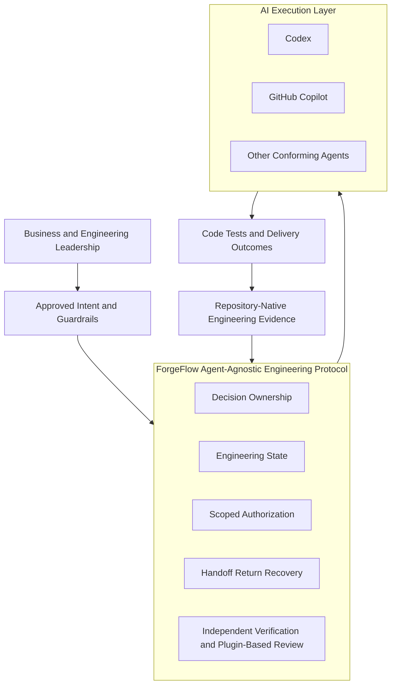
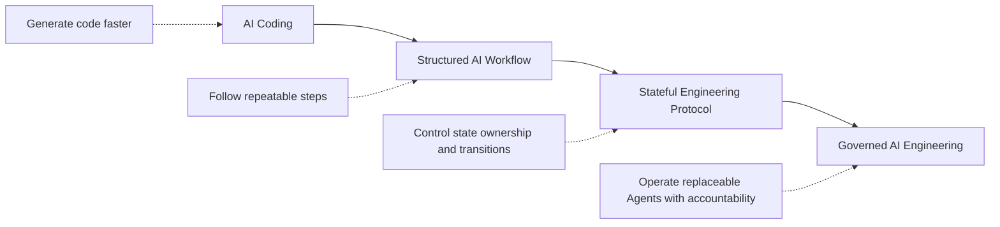
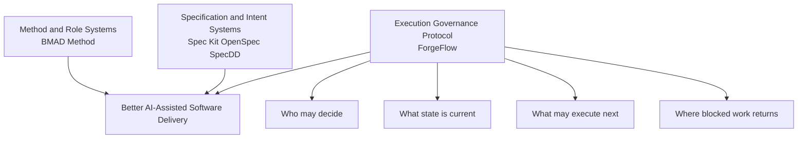

# ForgeFlow

## The Agent-Agnostic Engineering Protocol

>**A stateful execution protocol for AI-assisted software engineering.**
>
> **AI Agents execute. ForgeFlow governs execution.**

[中文版](./forgeflow-engineering-protocol.zh-CN.md)

---

## Executive summary

AI coding has made software creation faster, but speed alone does not create an
engineering system. As Agents take on more work, organizations still need clear
answers to five questions:

1. What is the approved scope?
2. Who is allowed to make each kind of decision?
3. What engineering state is true now?
4. What may the Agent do next?
5. Where should execution return when a downstream step exposes an upstream gap?

ForgeFlow provides a protocol layer for answering those questions consistently.
It does not compete with AI Agents, IDEs, or the SDLC. It governs how Agents
participate in engineering work so that execution remains bounded, traceable,
verifiable, and recoverable.

```mermaid
flowchart LR
    Intent[Human Intent] --> Protocol[ForgeFlow Engineering Protocol]
    Protocol --> Agents[Replaceable AI Agents]
    Agents --> Delivery[Software Delivery]
    Delivery --> Evidence[Engineering Evidence]
    Evidence --> Protocol

    Protocol --> Scope[Scope Control]
    Protocol --> Ownership[Decision Ownership]
    Protocol --> State[Persistent State]
    Protocol --> Quality[Independent Quality]
    Protocol --> Recovery[Return and Recovery]
```

---

## The idea behind ForgeFlow

Most AI development approaches focus on making the Agent more capable: better
prompts, richer context, more tools, or more autonomous execution. ForgeFlow starts
from a different premise:

> The strategic problem is not only how capable the Agent is. It is whether the
> engineering organization can control, understand, and recover the Agent's work.

ForgeFlow therefore separates four concerns:

| Principle | Meaning for leadership |
|---|---|
| **Artifacts preserve state** | Important decisions and evidence survive beyond a chat session. |
| **Workflows own decisions** | Business, engineering, implementation, and verification authority are separated. |
| **The Artifact Graph authorizes execution** | The next action is derived from current evidence rather than Agent confidence. |
| **Handoffs transfer execution** | A new phase or scope requires an explicit, validated transfer. |
| **Return and Recovery protect correctness** | Work moves back to the owner of a missing decision instead of hiding the problem downstream. |

---

## Leadership architecture

ForgeFlow is designed as a compact governance layer between organizational intent
and replaceable AI execution.

### Why this architecture matters

- **Agent independence:** the durable engineering state is not locked inside one
  vendor's model or chat history.
- **Organizational control:** authority is attached to roles and scopes, not to what
  an Agent happens to be capable of doing.
- **Auditability:** decisions and evidence remain visible in the repository.
- **Recoverability:** a different Agent or a new session can continue from current
  evidence.
- **Incremental adoption:** teams can use the protocol manually before introducing
  more automation.

ForgeFlow's normative Core is Agent-agnostic. Current dedicated launcher and
acceptance assets cover Codex and GitHub Copilot; other Agents are a compatibility
direction, not a current validated-integration claim.

---

## From AI coding to protocol-driven AI engineering

ForgeFlow is positioned at the protocol layer. Its goal is not to prescribe every
organizational process, but to make AI participation safe and intelligible inside
the process an organization already uses.

---

## What makes ForgeFlow distinctive

ForgeFlow's advantage is not one isolated feature. It is the combination of a small
set of controls that reinforce one another.

### 1. An engineering protocol, not another Agent

ForgeFlow remains useful when the preferred Agent changes. The protocol governs
authority, evidence, and transition; the Agent remains an execution participant.

### 2. Engineering state outside the conversation

Project truth is preserved as repository evidence. This reduces dependency on long
chat histories, hidden memory, and one model's interpretation of previous work.

### 3. Explicit decision ownership

ForgeFlow separates business clarification, engineering design, delivery
decomposition, implementation, and independent verification. This addresses a
common AI failure mode: making every unresolved decision locally because the Agent
can produce a plausible answer.

### 4. Controlled units of execution

Each execution receives one authorized Workflow and Scope. A future Feature or
Slice requires a new Handoff. This keeps ordered work visible and prevents several
delivery units from being silently merged into one Agent turn.

### 5. Return and Recovery as first-class behavior

When implementation exposes a missing business or engineering decision, ForgeFlow
routes the issue to the responsible owner. A new process can later recover from
persisted evidence rather than from remembered conversation state.

### 6. Verification separated from implementation

Review owns PASS/FAIL. Implementation does not approve itself, and additional
review rules can strengthen quality without changing that accountability model.

### 7. Plugin-Based Review as a governed extension

ForgeFlow allows teams to add Review plugins for concerns such as security,
architecture, coding standards, and performance. Plugins can introduce specialized
checks and supplemental reports without changing the Core Workflow or transferring
PASS/FAIL authority away from Review.

For leadership, this creates a practical balance: quality governance can evolve by
team, technology, or regulatory context while the final decision model remains
consistent, auditable, and centrally accountable.

### 8. Compact and inspectable by design

The Core is readable Markdown and the project state lives in the repository. The
control model is intentionally smaller than a full enterprise platform, making it
easier to audit, discuss, adapt, and contribute to as an open-source protocol.

---

## Open-source landscape

The projects below are strong in different areas. The comparison is about primary
design emphasis, not a claim that one project is universally better.

| Project | Primary emphasis | Characteristic strength | ForgeFlow's different emphasis |
|---|---|---|---|
| [GitHub Spec Kit](https://github.com/github/spec-kit) | Extensible, intent-driven Spec-Driven Development harness | Broad Agent integrations, reusable workflows, extensions, presets, and organizational catalogs | A smaller fixed control protocol centered on state, ownership, authorization, Return, and Recovery |
| [OpenSpec](https://github.com/Fission-AI/OpenSpec) | Fluid, artifact-guided SDD for brownfield and team use | Easy iterative proposal workflow, broad tool support, and cross-repository Stores in beta | Stronger execution boundaries and deterministic ownership/transition semantics |
| [BMAD Method](https://github.com/bmad-code-org/BMAD-METHOD) | Role-rich, Agile-inspired Agent methodology | Progressive context building, specialist roles, modules, and a comprehensive guided method | A compact protocol rather than a large role or methodology system |
| [SpecDD](https://github.com/specdd/specdd) | Small, local specifications beside the code | Agent-agnostic, source-adjacent shared truth that can be adopted gradually | A centralized lifecycle evidence graph with explicit cross-stage authorization and recovery |
| **ForgeFlow** | Stateful execution governance for AI-assisted engineering | Typed ownership, versioned engineering state, scoped authorization, independent Review, Return and Recovery | Optimized for teams that want stronger control over how Agents advance engineering work |

The comparison reflects the projects' official public documentation as reviewed on
2026-08-19. Their capabilities may continue to evolve.

---

## Competitive position

ForgeFlow does not need to replace these projects to create value. Its strongest
long-term position is as the protocol layer that makes Agent execution governable,
whether the surrounding organization uses a traditional SDLC, Agile practices, or
a specification-driven method.

---

## Why an organization may choose ForgeFlow

| Leadership need | ForgeFlow value |
|---|---|
| Use multiple AI coding tools without losing process continuity | Engineering truth remains outside the Agent |
| Reduce silent scope expansion | Every execution has an explicit Workflow and Scope |
| Preserve business and engineering decisions | Versioned artifacts form a durable history |
| Improve accountability | Each class of decision has one authoritative owner |
| Recover safely after failure or interruption | Return and Recovery are part of the protocol |
| Introduce governance without a heavy platform | Markdown Core and repository-native evidence support gradual adoption |
| Create an open foundation for future automation | Protocol semantics remain separable from any one runtime or vendor |

---

## Recommended adoption path

1. **Start visibly:** use ForgeFlow on a bounded project with manual IDE-assisted
   execution and review each transition.
2. **Measure the controls:** evaluate scope discipline, decision traceability,
   recovery quality, and Review independence.
3. **Standardize the protocol:** establish organizational expectations for artifact
   quality, ownership, and acceptance evidence.
4. **Automate selectively:** introduce orchestration only after the underlying
   execution behavior is trusted.
5. **Expand Agent choice:** validate additional adapters without moving project
   truth into any individual Agent platform.

---

## Current boundary

ForgeFlow is a Technical Preview. It currently provides an Agent-agnostic Markdown
Core, dedicated Codex and GitHub Copilot launchers, repository-native engineering
evidence, Review extensions, an installer-only npx package, and an optional Python
reference CLI.

It does not claim guaranteed model correctness, universal Agent integration,
concurrent distributed-Agent orchestration, a hosted control plane, or replacement
of source control, CI, security controls, engineering leadership, and human
accountability.

---

## Leadership takeaway

> **The next stage of AI-assisted development is not only better code generation.**
>
> **It is the ability to govern changing AI Agents through durable state, explicit
> ownership, controlled transitions, independent verification, and reliable
> recovery.**

That is the role ForgeFlow is designed to play.
