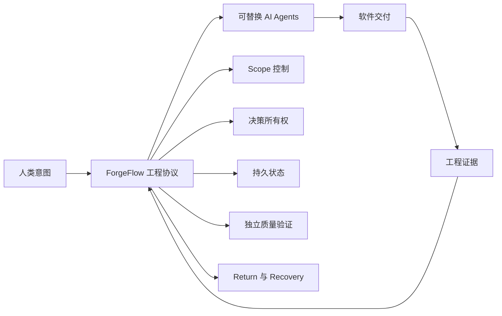
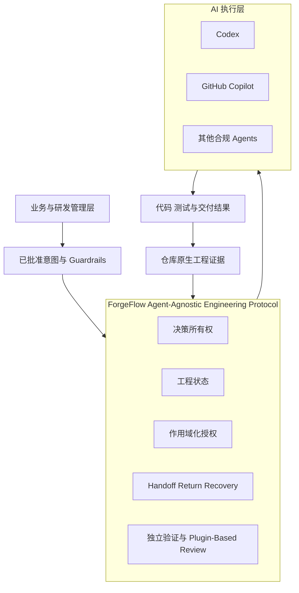
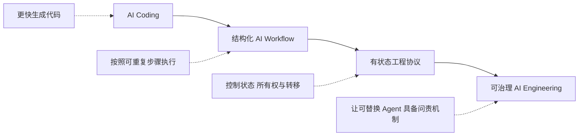
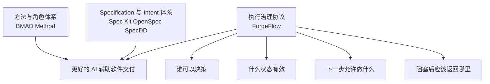

# ForgeFlow

## Agent-Agnostic Engineering Protocol

>**A stateful execution protocol for AI-assisted software engineering.**
>
> **AI Agents execute. ForgeFlow governs execution.**
>
> **AI Agent 负责执行，ForgeFlow 负责治理执行。**

[English](./forgeflow-engineering-protocol.en.md)

---

## 管理层摘要

AI Coding 显著提升了软件生产速度，但速度本身并不能构成一套工程体系。当 Agent
承担越来越多工作时，组织仍然需要明确回答五个问题：

1. 已批准的 Scope 是什么？
2. 每一类决策由谁负责？
3. 当前什么工程状态才是真实的？
4. Agent 下一步被允许做什么？
5. 下游暴露上游缺口时，执行应该返回哪里？

ForgeFlow 提供了一层能够稳定回答这些问题的工程协议。它不与 AI Agent、IDE 或
SDLC 竞争，而是治理 Agent 如何参与工程交付，使执行保持有边界、可追踪、可验证、
可恢复。

---

## ForgeFlow 的核心理念

大多数 AI 开发方案主要提升 Agent 的能力：更好的 Prompt、更丰富的 Context、更多
工具，或者更高程度的自主执行。ForgeFlow 从另一个前提出发：

> 真正的战略问题不只是 Agent 有多强，而是工程组织能否控制、理解并恢复 Agent
> 的工作。

因此，ForgeFlow 将以下职责明确分离：

| 核心原则 | 对管理层的含义 |
|---|---|
| **Artifacts 保存状态** | 重要决策和证据不会随着聊天会话结束而消失。 |
| **Workflows 拥有决策** | 业务、工程、实现和验证权限相互分离。 |
| **Artifact Graph 授权执行** | 下一步工作从当前证据推导，而不是取决于 Agent 的自信程度。 |
| **Handoffs 转移执行** | 进入新的阶段或 Scope 必须经过显式、可验证的交接。 |
| **Return 与 Recovery 保护正确性** | 问题返回缺失决策的 Owner，而不是被隐藏在下游实现中。 |

---

## 管理层架构图

ForgeFlow 是位于组织意图与可替换 AI 执行之间的一层轻量治理协议。

### 这套架构为什么重要

- **Agent Independence：** 长期工程状态不会被锁定在某个厂商模型或聊天历史中。
- **组织控制：** 权限绑定在角色与 Scope 上，而不是绑定在 Agent 能做什么上。
- **可审计：** 决策与证据持续保存在仓库中。
- **可恢复：** 新会话或不同 Agent 可以从当前证据继续工作。
- **渐进式采用：** 团队可以先手动使用协议，再逐步增加自动化。

ForgeFlow 的规范 Core 是 Agent-agnostic。当前专用 Launcher 与验收资产覆盖 Codex
和 GitHub Copilot；其他 Agent 属于兼容方向，不是当前已验证集成声明。

---

## 从 AI Coding 走向 Protocol-Driven AI Engineering

ForgeFlow 位于协议层。它并不规定组织必须采用哪一种 SDLC，而是让 AI Agent 在
组织既有流程中的参与变得安全、透明和可理解。

---

## ForgeFlow 与众不同的地方

ForgeFlow 的优势并不是某一个孤立功能，而是一组彼此强化的控制机制。

### 1. 它是一套工程协议，而不是另一个 Agent

当组织更换 Agent 时，ForgeFlow 仍然有效。协议负责治理授权、证据和转移，Agent
只是工程执行的参与者。

### 2. 工程状态存在于对话之外

项目事实被保存为仓库证据，降低了对超长聊天历史、隐藏 Memory 和单一模型解释的
依赖。

### 3. 决策所有权清晰

ForgeFlow 分离业务澄清、工程设计、交付拆分、实现和独立验证，解决 Agent 因为
能够给出一个看似合理的答案，就在当前环节自行决定所有问题的风险。

### 4. 执行单元受到控制

每次执行只获得一个 Workflow 与 Scope。未来 Feature 或 Slice 必须通过新的
Handoff。这让工作顺序保持可见，避免多个交付单元被静默合并到一次 Agent 执行中。

### 5. Return 与 Recovery 是一等能力

当实现发现业务或工程决策缺失时，ForgeFlow 将问题返回对应 Owner。新进程可以从
持久化证据恢复，而不依赖上一个会话的记忆。

### 6. 验证与实现相互独立

Review 独占 PASS/FAIL。实现不能自我批准，附加 Review 规则可以增强质量，但不会
改变最终责任边界。

### 7. Plugin-Based Review：可治理的质量扩展

ForgeFlow 支持团队以 Review Plugin 的方式增加安全、架构、编码规范和性能等专项
检查。Plugin 可以产生专业检查结果与补充报告，但不会修改 Core Workflow，也不会
把 PASS/FAIL 权限从 Review 转移出去。

对管理层而言，这实现了一个重要平衡：质量治理可以根据团队、技术栈或合规要求持续
演进，同时最终决策模型仍然保持一致、可审计，并具有明确责任主体。

### 8. 设计紧凑且可检查

Core 是可阅读的 Markdown，项目状态保存在仓库中。相比大型企业平台，这个控制模型
更小，更容易审计、讨论、调整和作为开源协议共同建设。

---

## GitHub 开源项目横向比较

以下项目分别在不同方向上具有明显优势。本比较关注它们的主要设计重心，并不表示
某一个项目在所有场景下都更好。

| 项目 | 主要定位 | 代表性优势 | ForgeFlow 的不同侧重点 |
|---|---|---|---|
| [GitHub Spec Kit](https://github.com/github/spec-kit) | 可扩展、意图驱动的 Spec-Driven Development Harness | 广泛 Agent 集成、可复用 Workflow、Extension、Preset 与组织 Catalog | 更小、更固定的控制协议，强调状态、所有权、授权、Return 与 Recovery |
| [OpenSpec](https://github.com/Fission-AI/OpenSpec) | 面向 Brownfield 与团队的流动式 Artifact-Guided SDD | 易用的迭代式 Proposal Workflow、广泛工具支持，以及 Beta 阶段的跨仓库 Stores | 更强的执行边界与确定性 Ownership/Transition 语义 |
| [BMAD Method](https://github.com/bmad-code-org/BMAD-METHOD) | 角色丰富、Agile 启发的 Agent 方法体系 | 渐进式 Context 构建、专家角色、Module 与完整引导方法 | 重点是一套紧凑协议，而不是大型角色或方法论系统 |
| [SpecDD](https://github.com/specdd/specdd) | 与代码相邻的小型本地 Specification | Agent-agnostic、Source-Adjacent Shared Truth，可渐进采用 | 集中的生命周期证据图，以及显式跨阶段授权与恢复 |
| **ForgeFlow** | AI 辅助工程的有状态执行治理 | 类型化所有权、版本化工程状态、作用域化授权、独立 Review、Return 与 Recovery | 适合希望更严格控制 Agent 如何推进工程工作的团队 |

本比较基于各项目截至 2026-08-19 的官方公开文档；相关能力仍可能持续演进。

---

## ForgeFlow 的竞争位置

ForgeFlow 不需要替代这些项目才能产生价值。它最有潜力的长期定位，是成为让 Agent
执行可治理的协议层，不论外围组织使用传统 SDLC、Agile 实践，还是 SDD 方法。

---

## 企业为什么可能选择 ForgeFlow

| 管理层需求 | ForgeFlow 提供的价值 |
|---|---|
| 同时使用多种 AI Coding 工具又不丢失流程连续性 | 工程事实存在于 Agent 之外 |
| 减少 Scope 静默扩张 | 每次执行都有明确 Workflow 与 Scope |
| 保存业务与工程决策 | 版本化 Artifact 形成长期历史 |
| 提升问责能力 | 每一类决策只有一个权威 Owner |
| 在失败或中断后安全恢复 | Return 与 Recovery 属于协议本身 |
| 不引入重型平台也能建立治理 | Markdown Core 和仓库原生证据支持渐进采用 |
| 为未来自动化建立开放基础 | 协议语义与任何单一 Runtime 或厂商保持分离 |

---

## 建议采用路径

1. **从可见执行开始：** 在边界清晰的项目中使用 IDE 手动运行 ForgeFlow，并检查
   每一次 Transition。
2. **验证控制效果：** 观察 Scope Discipline、决策可追踪性、Recovery 质量和 Review
   独立性。
3. **形成组织标准：** 明确 Artifact 质量、Ownership 与 Acceptance Evidence 要求。
4. **选择性自动化：** 只有在底层执行行为足够可信后，才引入更多自动编排。
5. **扩展 Agent 选择：** 验证新的 Adapter，但不把项目事实迁移到某个 Agent 平台。

---

## 当前边界

ForgeFlow 当前处于 Technical Preview。已经提供 Agent-agnostic Markdown Core、
Codex 与 GitHub Copilot 专用 Launcher、仓库原生工程证据、Review Extensions、只负责
安装的 npx Package，以及可选 Python 参考 CLI。

ForgeFlow 不宣称能够保证模型永远正确、已经集成所有 Agent、支持并发分布式 Agent
编排或提供 Hosted Control Plane；它也不替代源代码管理、CI、安全控制、工程领导力
和人的最终责任。

---

## 给管理层的最终结论

> **AI 辅助开发的下一阶段，不只是生成更好的代码。**
>
> **它需要通过持久状态、明确所有权、受控转移、独立验证和可靠恢复，治理不断变化
> 的 AI Agent。**

这正是 ForgeFlow 希望承担的角色。
